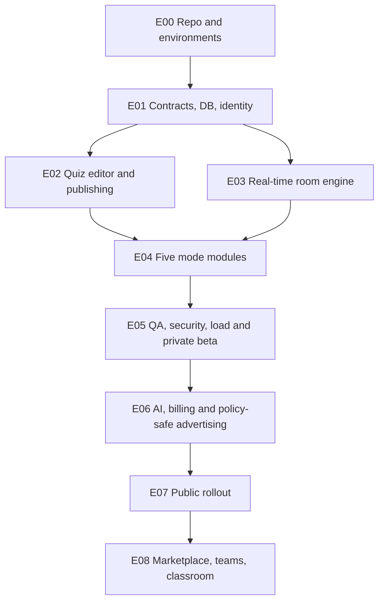

# MULTIGAME — MASTER BUILD PROMPT FOR AN AUTONOMOUS CODING AGENT

**Instructions to the implementing AI / engineering team.** This entire file is the prompt. It includes an execution contract, a detailed creative/visual direction, a technical quality contract, and all three original project documents reproduced below. Do not rely on earlier chat history. Build the working product, not a conceptual mockup.

## 0. Role, objective, and non-negotiable outcome

You are acting as a senior multidisciplinary product engineering team: principal full-stack engineer, real-time systems architect, gameplay engineer, motion designer, design director, accessibility engineer, security reviewer, and QA lead. Your mission is to DESIGN, IMPLEMENT, TEST, and, when access and authorization allow, DEPLOY **MULTIGAME**, a production-quality browser-based multiplayer game-show builder.

**Essential product premise:** A host mixes five different interactive games into one playable quiz; guests enter a PIN/QR/link without making accounts, play on their phones in one continuous room, and compete on one cumulative leaderboard. Modes: (1) Fermi numerical estimation; (2) Rare Answers / Krillion-style uniqueness; (3) Wordle-style hidden-word puzzle; (4) Size It Up calibrated visual scaling; (5) Amountle tactile count/pour estimation. Hosts can create, edit, reorder, preview, save, share, and run quizzes. Offer free manual play supported by nonintrusive advertising and premium ad-free hosting with approved AI-assisted quiz creation. Preserve the full five-mode product promise.

**Do not stop after:** generating a landing page, writing a PRD, creating static mock screens, a pretty prototype, or scaffolding. Every implemented UI must be connected to working state and persistence. No fake buttons, placeholder database records masquerading as real data, fabricated integrations, hard-coded winners, or deceptive “ready” labels. Use mocked services exclusively in tests/local previews and clearly mark them.

**Read the attached specification appendices BEFORE coding.** Apply priority in order: (1) explicit requirements in this master prompt; (2) Engineering Implementation Plan V3; (3) Development-Ready Specification V2; (4) Product Vision V1. Where older docs disagree, prefer higher-priority source; record disagreements and decisions in `docs/DECISIONS.md`. Unspecified implementation details: choose safe, simple, reproducible defaults and document why. Never silently delete a requested feature because it is difficult.

## 1. Execution behavior and autonomy

1. Inspect the real repository and infrastructure first. If empty, initialize it. If code exists, audit relevant files, reuse viable systems, and avoid unrelated refactors.
2. Write a concise execution plan with prioritized milestones and dependencies in `docs/IMPLEMENTATION_STATUS.md`; then IMPLEMENT. Do not keep producing planning documents instead of code.
3. Execute work in small coherent units. For each unit: code, migrations, tests, visual validation, error handling, and an updated status record. Run actual commands, inspect failures, fix them, and rerun. Never report tests as passing unless executed successfully.
4. If context/time/permissions interrupt execution, preserve a precise handoff: working functionality, failing checks, commands executed, commits, environment gaps, blocked items, and the exact next action. Do not claim deployment unless the deployed URL has been verified.
5. Avoid unnecessary questions. Ask only when a blocked external action, irreversible operation, missing secret/permission, or consequential product/legal decision genuinely cannot be resolved safely from the specification. Continue on independent work in the meantime.
6. Never commit secrets, personally identifying quiz answers, private content, or payment credentials. Use environment configuration and explain required secrets without printing them.
7. Prefer maintainable, understandable source code over clever abstractions. Architect for new minigames, but do not overbuild an arbitrary plugin framework before shipping the five modes.
8. Make the end result available through a working URL when deployment privileges permit, plus repository changes and validation results. If no deployment permission exists, produce a reproducibly runnable local/staging build and explicit deployment instructions.

## 2. Visual excellence: priority equal to functionality

**The visual bar is extremely high.** Build an original, visually memorable, professionally art-directed entertainment product. The design should feel like a premium interactive game show created by an elite digital product studio. The desired ambition is comparable to the unusually polished frontend motion and composition sometimes seen in top-tier coding/model showcases (the user specifically referenced “Opus 5.5” as an aesthetic/implementation benchmark). This is a *quality direction*, not a claim that any particular model provides assets or a requirement to imitate proprietary work.

### 2.1 Strict anti-generic-AI-design rules

- Absolutely avoid the recognizable generic AI-generated SaaS look: repetitive purple/blue gradients, floating glass cards everywhere, excessive blur, identical rounded rectangles, random glowing orbs, cliché hero grids, boring dashboard icons, generic emoji-as-art, default Tailwind/shadcn appearances, cheap stock images, monotonous fonts, and giant empty areas with tiny content.
- Do not substitute “lots of particles and gradients” for strong art direction. Prioritize graphic hierarchy, composition, rhythm, contrast, personality, legibility, restrained materials, authentic game objects, and distinct interactions.
- Use a coherent custom typographic system, a deliberate palette, carefully tuned spacing, controlled texture and shadows, crafted surfaces, elegant lighting, and a small set of reusable motion principles. For public/marketing screens, bold editorial composition is encouraged; for play, clarity and fast interaction always win.
- Create an original MULTIGAME identity: wordmark, icon language, round identity system, polished loading states, purposeful microcopy, and custom result treatments. Do not copy Kahoot, Wordle, Krillion, Fermi, Size It Up, or another brand's protected visual identity/assets; reference only broad mechanic concepts and create original expression.
- No mismatched fonts, clipped or overlapping text, unreadable gradients, horizontal overflow, awkward mobile paddings, floating tooltips offscreen, illegible text on dynamic backgrounds, stretched sprites, robotic copy, or motion that delays input.

### 2.2 Visual creative direction

Explore a distinctive fusion of **contemporary game-show broadcast graphics + tactile mini-games + playful editorial interaction**, not a business SaaS dashboard. Distinguish marketing/host/builder/player/projector states while sharing a recognizable family identity. Use one coherent design system and give each minigame its own accent, motion vocabulary, and tactile materials without fragmenting the product.

Required screen polish:

- **Homepage:** Art-directed, immediately understandable promise; animated interactive showcase illustrating all five mechanics; unmistakable primary `Create a game` and `Join a game` paths; credible sample gameplay; polished responsive sections without endless scrolling or template-feeling cards.
- **Creator:** An intuitive timeline of rounds with rich thumbnails, strong drag affordance, immediate live previews, elegant inline editing, clear mode picker, meaningful empty states, accurate save indicators, and clean Simple/Advanced controls. Beautiful, but never visually overwhelming.
- **Lobby:** Large memorable PIN, scannable QR, lively but tasteful player-join animation, host controls, coherent spectator view, accessible count/status; modern big-screen readability at a distance.
- **Gameplay:** Immersive, full-screen-first phone controls, large touch targets, clear question/title/timer/submit hierarchy, powerful feedback for every tap, low cognitive load, solid connection/sync status, minimal chrome.
- **Reveals:** Distinct but coherent choreography: anticipation, correct answer, comparison, points, leaderboard; fast/skippable; no blocking after a host advances.
- **Podium/end:** Memorable celebratory conclusion with real data, delightful character, tasteful confetti/motion, and immediate play-again/duplicate/share actions.

### 2.3 Required unique motion per mode

1. **Fermi:** Numbers glide onto a well-calibrated dynamic axis; guesses become animated markers; truth lands with a precise highlight; reveal closest/biggest over/under without chart-label collisions. Axis handles enormous numeric range, zero, and negatives by defined scale behavior.
2. **Rare Answers:** Submitted responses become thoughtfully clustered tiles/bubbles sized by frequency; rare responses separate with a premium dramatic accent; host adjudication reshuffles the chart correctly. No overwhelming visual noise.
3. **Word Puzzle:** A bespoke grid with tactile key presses, staggered tile flips, restrained success choreography, reduced-motion alternative, exact duplicate-letter feedback and keyboard accessibility.
4. **Size It Up:** Smooth, precise resize/pinch/slider response; aligned calibrated outlines; high-impact true-scale reveal; visually compare reference/guess/truth without distortion or viewport-dependent scoring.
5. **Amountle:** Exceptionally satisfying pouring/dropping interface: responsive continuous pour, believable lightweight particles and collisions where practical, controlled aggregation for large counts, clear count and sync/lock indicator, burst/settling reveal. Physics is DECORATION; canonical score uses integer state.

### 2.4 Interaction/motion implementation discipline

- Use CSS motion for simple transitions, and a well-supported motion library or Canvas/WebGL where their benefits are measurable. Don't pull heavyweight animation dependencies into every player screen without reason. Avoid main-thread animation bottlenecks and long hydration times.
- Define design tokens for colors, typography, spacing, radii, layer depth, motion durations/easings, sound themes and accessibility variants.
- Aim for smooth 60fps interactions on representative modern devices, degrade gracefully on slower phones, obey `prefers-reduced-motion`, support mute, avoid autoplay audio restrictions, and never block critical gameplay while waiting for an animation.
- Target responsive widths around 320, 375, 390, 768, 1024, 1440 and large-format projector displays. Verify safe areas, portrait and landscape, keyboard-only play, high text zoom and touch use.
- Every user-facing screen must have intentional loading, empty, error, disconnected, reconnecting, restored, and success states. Use skeletons only when honest; no endless fake spinners.
- Capture and REVIEW screenshots of key flows in mobile and desktop via browser-based visual QA. Inspect them, identify visual defects, repair and recapture. A visually strong homepage is insufficient: all five play modes, editor, lobby, host screen, projector, reveals, and end screens must meet the same standard.
- Keep layouts and effects original; do not claim visual quality without inspecting rendered screenshots/video.

## 3. Product functionality: no missing pieces

**Implement the complete V3 contract below**, including:

- Creator authentication, owned/private quiz library, five mode-specific editors, Basic/Advanced controls, draft autosave with revision conflict handling, immutable published versions, preview/simulation, duplicate/reorder and mode-specific publish validation.
- Accountless player PIN/QR joining with nickname, participant-scoped resume credentials, role-based permissions, host moderation, separate read-only display pairing, synchronized game room, authoritative timers, pause/resume/extend/skip/advance, explicit answer acknowledgments, reconnect/snapshot recovery, cumulative leaderboard, role-filtered results and share flow.
- Every scoring and input edge case specified in V3: proportional Fermi with zero/negative fallback; live-room Rare Answers with normalization, aliases, host decisions and recomputation; Word Puzzle two-pass repeated-letter feedback and grapheme support; calibrated viewport-independent Size It Up; integer-authoritative Amountle with revision/ack handling and bounded particle count.
- Question provenance and accuracy status; no invented personal fact presented as verified; creator review of AI output; deterministic validation where possible; optional moderated/manual arbitration; data minimization for personal quizzes.
- Ad-supported free offering and premium ad-free AI functionality, with all financial and legal gating clearly enforced: no ads in active round/countdown/reveal, never assume children can be targeted, enforce entitlement server-side, payment webhooks idempotent and signed, AI costs/quotas measured, and unaudited business assumptions flagged.
- Administrative moderation, abuse/report paths, privacy settings, error monitoring, metrics, backup/restore, accessibility, analytics events, testing, and operations needed for a responsible launch.

**Launch scope:** all five modes are required. Marketplace, global-frequency rarity, teams, classroom product, native apps, tournaments, and advanced community tools are future phases unless V3 says otherwise. Avoid launch-blocking scope creep.

## 4. Concrete technical defaults and source contracts

- Start with pnpm TypeScript monorepo: `apps/web` (Next.js), `apps/game-service` (long-lived Node/Socket.IO), `apps/worker`; `packages/contracts`, `packages/game-modes`, `packages/db`, `packages/ui`; `infra`, `tests`, and `docs`.
- PostgreSQL is persistent canonical state; Redis is supporting ephemeral coordination, never sole authority. Durable session events/outbox and idempotency receipts prevent lost or duplicate effects. Server timestamps and versioned states govern deadlines and scoring.
- Shared Zod contracts for JSON HTTP API, discriminated question-mode configs, versioned socket event payloads, role-filtered snapshots; generate API documentation and test fixtures.
- Build the exact route table, database entities/constraints, HTTP routes, socket protocol, state machine, scoring logic, and acceptance tests from V3. Keep correct answers and future-round secrets off player and projector transport until reveal.
- If newer versions of frameworks or providers materially affect design, verify currently supported versions/docs/advisories and document version pins in `docs/DECISIONS.md`. No undocumented wholesale stack swaps.
- Commit schema migration code, a seed demo covering all five modes, deterministic unit tests, integration tests, browser E2E with multi-player devices, load tests, screenshots, and deploy scripts/CI.

## 5. Definition of done for each feature and each epic

A task is NOT complete unless all apply:

1. A real user can navigate it and its advertised interaction works, including mobile and keyboard/fallback behavior.
2. Permissions and server-side validation enforce its rules; malformed/late/replayed inputs are rejected safely.
3. State survives the appropriate refresh/reconnect/crash cases, and scores remain mathematically correct and exactly-once in effect.
4. Automated unit/integration/E2E tests cover happy path and major edge cases and have ACTUALLY been run.
5. Visual verification at mobile and desktop shows polished layout, typography, animation, and states; defects fixed.
6. Accessibility, reduced-motion, performance, privacy/security, loading and error paths have been reviewed.
7. Observability/logging and product telemetry exist without overcollection of personal data.
8. Docs and implementation-status record reflect actual behavior and any remaining gaps.

**Public launch gates:** five-mode end-to-end session, realistic multi-device beta, no known critical accessibility/security defects, forced-kill recovery proven, proven capacity cap, payments/ad policy/legal review, and complete support/rollback runbook. If a gate is missing, keep it behind feature flags and do not claim full production readiness.

## 6. Implementation order — begin now

Follow the EPIC 00→07 sequence and exact ticket IDs/acceptance criteria in V3; E08 is deferred. First deliver bootstrap/CI, shared contracts, migrations/outbox, identities/PIN, state machine/recovery, live gateway, builder/editor, then the five independent mechanics and exquisite visuals, then QA, private beta, AI/payments/ads, and staged public deployment. Parallelize only after common contracts exist. Build vertical end-to-end slices wherever possible; keep the application continuously runnable.

**First working milestone:** host signs in, creates a five-question quiz (one of each mode), starts a room, two guests join by PIN from separate devices, complete the five mode-specific interactions, see correct server-scored reveals and final rankings, and can recover after a refresh. No mocks in this milestone.

**Every update to the human:** briefly report what is implemented (not merely designed), link or show verifiable artifacts when available, list tests actually run, identify blockers, and say exactly what comes next. Do not waste response space restating the brief.

---

# APPENDIX A — FULL ENGINEERING IMPLEMENTATION PLAN V3 (AUTHORITATIVE DETAIL)

# MULTIGAME — Engineering Specification & Full Implementation Plan

**Version:** 3.0 · **Date:** 16 October 2026 · **Status:** Build-ready proposed baseline; product, legal and commercial gates explicitly identified\
**Inputs:** MULTIGAME Vision V1.0 and Product Audit/Specification V2.0. This document is the implementation extension to V2; where requirements conflict, the explicitly versioned decisions in this document govern implementation.\
**Audience:** Founders, product designer, full-stack engineers, backend/real-time engineers, QA, DevOps, security/privacy reviewers.

> **Product invariant:** A creator combines five distinct minigames in one quiz; players join without accounts and complete all five through the same room and shared leaderboard. Core modes: Fermi, Rare Answers (Krillion-style), Word Puzzle (Wordle-style), Size It Up, Amountle. Free manual hosting and play; premium AI/ad-free experience; ads never interrupt gameplay.

## A. Implementation decisions and open gates

| ID      | Status         | Decision                                                                                                    | Rationale / consequences                                                                                        |
| ------- | -------------- | ----------------------------------------------------------------------------------------------------------- | --------------------------------------------------------------------------------------------------------------- |
| ADR-001 | Proposed fixed | Monorepo: pnpm workspaces + TypeScript + Next.js web + long-lived Node.js game service                      | Shared types with dedicated real-time lifecycle. Do not run authoritative timers only in a serverless function. |
| ADR-002 | Proposed fixed | PostgreSQL is canonical; Redis used for ephemeral coordination/cache; server writes state before broadcasts | Restart and reconnect cannot depend on transient memory or Pub/Sub messages.                                    |
| ADR-003 | Proposed fixed | Socket.IO transports live events, and every participant can request a role-filtered canonical snapshot      | Default Socket.IO delivery is at-most-once; application supplies retries + idempotent mutations.                |
| ADR-004 | Proposed fixed | Five core modes ship before public release; all five are available without premium                          | Preserves product promise.                                                                                      |
| ADR-005 | Proposed fixed | Each round is worth at most 1,000 baseline points; no speed bonus in initial release                        | Simpler fairness; compare score distributions in beta before introducing speed.                                 |
| ADR-006 | Proposed fixed | Players anonymous/pseudonymous, hosts authenticated; private quiz by default                                | Easy joining and minimized personal data.                                                                       |
| ADR-007 | Proposed fixed | All AI output drafts require creator approval, never unreviewed live grading                                | Avoid unsupported assertions and live-score disputes.                                                           |
| ADR-008 | Proposed fixed | Adult-hosted private parties first; no child-targeted advertising or classroom launch without review        | Different privacy obligations and moderation workflows.                                                         |
| ADR-009 | Proposed fixed | No public quiz marketplace on initial public release; link-only sharing and templates curated by staff      | Moderation and discovery can follow demonstrated retention.                                                     |
| ADR-010 | To validate    | Payment prices, event pass, premium quotas, eligible countries, ad providers                                | Financial/user testing and legal/privacy review.                                                                |
| ADR-011 | To validate    | 100 players/room and 100 rooms × 50 players test thresholds                                                 | Engineering launch targets, not capacity guarantees.                                                            |
| ADR-012 | To validate    | 1,000-point formulas and tolerances for the five modes                                                      | Controlled playtests and mode-normalized distribution analysis.                                                 |
| ADR-013 | To validate    | Supported languages/Unicode behavior at launch                                                              | English fully tested; additional languages require mode-specific QA.                                            |
| ADR-014 | To validate    | Data retention and legal age policy                                                                         | Counsel approval before public monetization.                                                                    |

**Scope tiers**: **Alpha** = build/test without revenue; **Beta** = invited real players; **Public V1** = paid/advertising release after gates; **Post V1** = marketplace/global rarity/classroom/teams/mobile applications. These are deployment stages, not a reduction in the required five launch modes.

## B. Functional requirements (testable)

### Roles / permissions

- **Creator**: sign in, create/update/delete owned quizzes; edit draft rounds, preview, create sessions, view own aggregate analytics.
- **Host**: a creator acting in a live session; start/pause/extend/skip/advance, review submitted rare answers, moderate player names, end room. Never identified only by knowledge of the room PIN.
- **Player**: no account; join via PIN/deep link with nickname; receive session-scoped opaque credential; only submit their own answers; rejoin with valid scoped resume credential.
- **Display**: read-only paired projector identity. No secret correct answers until reveal; no host capabilities.
- **Moderator/admin**: read reports and take narrowly logged moderation actions; separate authorization from creators.

### Site routes and exact purposes

| Route                           | Allowed users         | Minimum functionality                                                     |
| ------------------------------- | --------------------- | ------------------------------------------------------------------------- |
| `/`                             | Everyone              | Explain offer, create CTA, join PIN, sample playable quiz                 |
| `/join` and `/join/[pin]`       | Everyone              | PIN entry, nickname, disclosure, join; errors for invalid/full/ended room |
| `/play/[sessionId]`             | Player                | Pre-lobby, active mode UI, confirmation, reconnect, per-player result     |
| `/create`                       | Signed-in creator     | Choose blank/sample/template, title, audience context                     |
| `/library`                      | Creator               | Search own drafts/private quizzes, duplicate, archive/delete              |
| `/quiz/[quizId]/edit`           | Owner                 | Simple/advanced mode editors, reorder, version, save, validate            |
| `/quiz/[quizId]/preview`        | Owner                 | Phone/host/display previews, simulate answer and reveal                   |
| `/host/[sessionId]`             | Host                  | Lobby, controls, review, scoreboard, events, recover host session         |
| `/display/[pairToken]`          | Scoped paired display | Projector-safe visuals without credentials/hidden answers                 |
| `/results/[sessionId]`          | Scoped host/player    | Final results with role-appropriate filtering                             |
| `/account`                      | Creator               | Settings, deletion/export requests, subscriptions                         |
| `/billing`                      | Creator               | Plan/payments/quota status, checkout and portal                           |
| `/privacy`, `/terms`, `/report` | Everyone              | Notices, terms, abuse reporting                                           |
| `/admin/*`                      | Staff only            | Moderation, abuse queues, operational diagnostics                         |

### Creator flow

1. Sign in; `Create quiz` defaults to **private**. Set title, description, language, and audience classification.
2. Press `Add round`, select among five modes. Show concise input fields; `Advanced settings` collapsed.
3. Input question, answer/reference, timer and provenance. For personal claims creator must supply true answers; objective answers may link evidence; subjective claims require declared host judgment.
4. See validity warnings and real-time mode preview. **Draft autosave** with optimistic revision and conflict indicator.
5. Reorder cards by keyboard-accessible controls or drag-and-drop, duplicate/delete, and preview whole quiz with simulated players.
6. Publish immutable **quiz revision** for a session (subsequent editing creates a new revision). Host can replay earlier revision or start a new session on latest.
7. Start live room; get six-digit PIN, QR/deep link, separate presentation-display pairing. Start with at least one participant; default soft warning if fewer than two.

### Player flow

1. Join link/PIN; choose nickname (1–24 visible characters); reserve profanity/moderation controls; duplicate nicknames allowed with discrete disambiguation or ask re-entry.
2. Receive securely scoped session membership, view lobby and connection status.
3. On each round, see one clear interaction, time left as synchronized estimate, and explicit `answer received` acknowledgment.
4. May revise an answer only when the round setting allows; last **server-accepted revision before deadline** wins. The server, not animation, determines the accepted answer.
5. See reveal and per-player points when host advances; no hidden opponent answers during active mode.
6. Refresh/reconnect and return to current state; completed or revoked room shows safe terminal screen.

### Host flow

1. Lobby displays count, sanitized nicknames, join URL, QR, kick/ban for current room, lock joining.
2. Preflight warns: unresolved factual provenance, missing/uncalibrated assets, unsupported mode configuration. Cannot start invalid quiz.
3. `Start` -> preparation -> countdown -> active -> lock -> evaluation/review -> reveal -> scoreboard -> advance.
4. Host may pause/extend/skip (with explicit rules below), end room, pair/revoke display device.
5. If host disconnects, room timer is unaffected; host returns using authenticated credentials and a current snapshot.

## C. Round lifecycle — mandatory state machine

```
LOBBY -> ROUND_PREPARE -> ROUND_COUNTDOWN -> ROUND_ACTIVE -> ROUND_LOCKED
                                                     |              |
                                                     v              v
                                                  PAUSED      ROUND_EVALUATING
                                                                    |
                                                         +----------+----------+
                                                         v                     v
                                                   REVIEW_REQUIRED        ROUND_SCORED
                                                         |                     |
                                                         +---------->----------+
                                                                               v
                                                                       ROUND_REVEAL
                                                                               |
                                                                          INTERMISSION
                                                                               |
                                    next round: ROUND_PREPARE <---------------+
                                    final round: SESSION_COMPLETED

any nonterminal host-eligible state -> SESSION_ABORTED (with reason)
```

**Transition contract**:

- Every mutation carries `expectedStateVersion`; server validates state+role+version and commits new state atomically. Duplicates return existing result.
- `deadlineAt` is stored as UTC server time. Countdown uses client clock offset only for display; acceptance compares server receive/commit cutoffs to deadline.
- **Pause**: write `pausedRemainingMs = max(0, deadlineAt - serverNow)` and set `PAUSED`; no submissions permitted while paused (UI overlay). **Resume** writes a new deadline and `ROUND_ACTIVE`. Log both actions.
- **Extend**: host adds a bounded duration (e.g., <=60 seconds per extension, maximum 3) before lock; new deadline version is broadcast; values are configuration policy, not universal constants.
- **Skip**: mark round void with zero points for all players, preserve prior leaderboard, reveal `Round skipped`, advance. Never treat skipped round as loss.
- **Lock**: persist locked round and cutoff, stop mutations, snapshot canonical valid latest submissions, then score.
- **Review**: rare-answer unresolved submissions enter `REVIEW_REQUIRED`; no final leaderboard until host approves/rejects or explicitly resolves all via documented policy.
- **Reveal**: only now send correct answer and score details to player/display scopes. No correctness-bearing payload earlier.
- **Finish**: after last reveal/intermission, commit final leaderboard and `SESSION_COMPLETED`; room becomes read-only.
- Auto-reconciler processes overdue timers on restart; use optimistic lock/CAS so multiple workers cannot each advance a room.

**Failure invariants**:

1. Never accept an answer for a different round, inactive room, unauthorized participant, or after the cutoff.
2. Every `(session, round, participant, scoringRevision)` ledger entry is unique.
3. Recalculating a round replaces `currentScoreRevision`; cumulative totals derive from one current revision per round (no double-counting).
4. Exactly one committed event sequence per session; all role projections generated server-side with redaction.
5. All states are recoverable from canonical database records; in-memory counters are disposable.

## D. Common scoring and answer schemas

```
type ModeId = 'fermi' | 'rare_answers' | 'word_puzzle' | 'size_it_up' | 'amountle';
type Provenance = 'verified_factual' | 'creator_confirmed' | 'host_judged' | 'needs_review';
type RoundStatus = 'draft' | 'validated' | 'published';
type CommonRound = {
  id: string; mode: ModeId; schemaVersion: number; question: string;
  timerSeconds: number; maxPoints: 1000;
  provenance: Provenance; sourceUrl?: string; explanation?: string;
  publicConfig: Record<string, unknown>; secretConfig: Record<string, unknown>;
};
type Evaluation = { valid: boolean; points: number; reasonCode: string;
  reveal: Record<string, unknown>; scoringVersion: string };
```

Pure module contract: `validateAuthorConfig`, `sanitizeAndValidateSubmission`, `score`, `publicQuestionProjection`, `revealProjection`, `getPreviewFixtures`. Input Zod discriminated union with JSON schema exported for documentation; deep versioned configs. **No client code receives secretConfig before reveal.** Score result is a pure function of canonical config + accepted submission + normalized answer groups where applicable.

### Mode 1: Fermi

- **Question**: positive/zero/negative number with unit, reference value, `errorMode` (`proportional` or `absolute`), upper/lower input bounds, timer and optional source.
- **Default positive answer `A>0`, guess `G>0`**: `score = round(1000 * min(G/A, A/G))`, clamped `[0,1000]`. `G<=0` earns zero in proportional mode. Example A=1000: G=900 ->900, G=1500 ->667, G=2000 ->500.
- **Absolute mode**, any real `A`: select author-controlled scale `T>0` (default derive from safe min/max range), `score = round(1000 * max(0, 1 - |G-A|/T))`. UI must show creator the score curve and reject `T<=0`.
- **Input**: numeric keypad, locale-aware display but canonical decimal parser; accept `K/M/B` on supported locales, reject NaN/Infinity, cap max absolute value, decimals precision/step. Store canonical decimal string if precision demands exactness.
- **Reveal**: answer + unit/source, answer distribution with log-scaled display for broad positive range (clearly labelled), closest, over/under. Never mix logarithmic visual position without axis label.
- **Tests**: positive A/G, zero answer, negative answer, negative in proportional mode, massive values/overflow, locale comma, multiple players tied, late answer, arbitrary text.

### Mode 2: Rare Answers (Krillion-style)

- **Question**: category prompt, bounded approved answer set or deterministic ruleset, normalization/aliases, `rarityMethod='live_room'`, score policy and adjudication mode. **Global rarity is Post V1.**
- **Normalize**: Unicode normalize NFKC, locale-aware trim/case-fold, collapse whitespace/punctuation by language profile; map aliases to one canonical value. Do NOT use naive substring matching. Define language normalization version.
- **Validation**: exact/alias match against answer catalog => accepted; obviously invalid => reject; otherwise queue host judgment. AI may suggest evidence but cannot unilaterally finalize ambiguous answers.
- **Frequency**: after validation, compute `n` accepted players, `f(answer)` number of players giving that canonical value. **Default score for each accepted answer**: `round(1000 * (n-f) / max(1,n-1))`; for `n=1`, grant 1000 to a valid answer; unique among 20 => 1000; 10 matches among 20 =>526. This deliberately differs from V1 illustrative scores and must be playtested. Invalid =0. Alternative: `minPoints` configurable after balancing.
- **Host review**: list unmatched strings sorted by answer grouping; accept with canonical alias, reject with reason, defer with safe fallback policy; audit actor/time, then recalculate all frequencies after each decision; close review only when none unresolved.
- **Collusion/ties**: same normalized answer always same score; all group sizes use final valid participating answers; players who submit nothing do not distort rarity distribution; warn if room of 1–2 players makes rarity trivial.
- **Reveal**: answer bubbles sized by frequencies; only display safe/moderated player content, anonymized if configured.
- **Tests**: accent/case/spelling, synonyms, aliases, repeated duplicates, zero valid responses, sole response, review changes frequency, adversarial markup, abuse text.

### Mode 3: Word Puzzle (Wordle-style)

- **Question**: canonical answer in supported language, clue, grapheme count (usually 4–8), attempt budget default six, dictionary policy (`standard`, `custom`, `unrestricted_valid_chars`), time limit.
- **Guess**: accepted only if grapheme length equals target and vocabulary policy passes; whitespace/punctuation visibility must be defined per question; not all personal nicknames are in dictionaries.
- **Feedback algorithm (mandatory two pass)**: (1) mark exact-position matches green and decrement letter counts; (2) for remaining positions mark yellow only while unmatched target occurrences remain; all others gray. Use Unicode graphemes, not JS string `.length`, and normalize consistently.
- **Attempts**: the server validates and stores every guess in one participant's round-attempt log; reject >max attempts and attempts after deadline. Never send other players' guesses.
- **Scoring**: solved on attempt 1..6 => `[1000,850,700,550,400,250]`; not solved =>0. Initial launch: no speed bonus. For custom attempt counts define `max(0,round(1000-(attempt-1)*150))` capped by configuration; avoid silent mismatch.
- **Reveal**: final word and per-person attempts, progress counts while active without letters.
- **Tests**: `BALLOON` repeated letters, multi-codepoint characters, keyboard controls, timeout mid-guess, race on sixth attempt, dictionary unavailable fallback, malicious custom text.

### Mode 4: Size It Up

- **Question**: approved SVG/transparent asset with metadata `measurementAxis`, intrinsic displayed dimension (pixels), measured intrinsic endpoints/bounds, reference real-world size >0, target real-world size >0 and unit. Only author-calibrated assets permitted for scored questions.
- **Scale math**: target/reference dimension ratio `R = targetDimension/referenceDimension`; player-adjusted ratio `P>0` derived from calibrated viewport-independent transform, NOT device pixel size. Score `round(1000*min(P/R,R/P))` with optional reviewed tolerance.
- **UI**: fixed reference object at known world-scale; resize secondary silhouette by slider, keyboard stepper or touch pinch; visible min/max, reset and `Lock Size`. Visual fit changes only rendering, not ratio.
- **Calibration editor**: creator selects measurement endpoints, enters real dimension and reference; show calibration preview. Reject uncalibrated uploads, images with undefined dimensions, cross-axis comparisons (width vs height) unless explicitly converted, nonpositive values.
- **Reveal**: true outline overlay at real ratio, player's outline, numeric relation and delta with unit/source.
- **Tests**: portrait/landscape, device pixel ratios, zoom, 320px screens, image rotation, enormous scale, keyboard-only, user uploads with orientation metadata.

### Mode 5: Amountle

- **Question**: nonnegative integer answer, maximum permitted count, timer, object art/theme. Canonical gameplay state is an **integer count**, NOT rigid-body physics.
- **Controls**: tap +1, press/hold accelerating controlled addition, adjustable batch `+1/+10/+100` as configured, undo/remove only if question allows, `Lock Amount`. Display current count by default; optional hide-count mode separately validated.
- **Absolute small-target mode** (proposed for `answer <=100`): creator-tuned `T=max(5,ceil(0.5*A))`, points `round(1000*max(0,1-|G-A|/T))`. For `A>100`, proposed proportional ratio (Fermi). **Must evaluate discontinuity and recalibrate**, especially A near 100; do not promise fairness untested.
- **Event model**: client holds local integer count; coalesce animation frames, send current absolute count + monotonic `revision` and `clientMutationId` at throttled interval and final commit. Server ignores duplicate or stale revisions, clamps safe ranges, and accepts only before deadline. **At deadline server uses last acknowledged count**, so UI clearly distinguishes `synced` from `pending`; optional final `Lock` submits via ack.
- **Visuals**: cap particles at 60 simultaneously; aggregate larger counts with stacking labels and progress gauge, never simulate 10,000 separate colliders. Reduced-motion draws static symbols.
- **Tests**: rapid 2,000 taps, hold on background tab, switch network, stale packets, 0 answer, maximum count, no double-count, target impossible given timer, keyboard numeric fallback.

## E. Data model — SQL-grade requirements

**Use UUIDs for durable IDs; timestamps `timestamptz`; `jsonb` only for versioned mode-specific configuration, not mutable aggregates.** All child rows specify FK and index policies. Recommended migration order:

1. `users (id PK, email unique nullable, created_at, deleted_at, settings_json)`; `creator_sessions`/identity-provider mapping; roles not solely inferred from email.
2. `quizzes (id PK, owner_id FK, title, description, language, visibility, audience_context, status, latest_revision, created_at, updated_at)`; owner index; soft delete.
3. `quiz_versions (id PK, quiz_id FK, version_num, status, created_at, UNIQUE(quiz_id,version_num))` immutable once published.
4. `rounds (id PK, quiz_version_id FK, ordinal, mode, schema_version, common_config jsonb, public_config jsonb, secret_config jsonb, scoring_version, provenance, source_url, UNIQUE(quiz_version_id,ordinal))`.
5. `assets (id PK, owner_id FK, storage_key, content_type, byte_size, processing_status, license_attestation, calibration jsonb, created_at)`; signed serving URLs.
6. `sessions (id PK, quiz_version_id FK, host_id FK, pin_lookup_digest UNIQUE, state, state_version, active_round_id nullable, deadline_at, paused_remaining_ms, next_event_seq, join_locked, created_at, completed_at)`.
7. `participants (id PK, session_id FK, nickname, display_name_norm, resume_token_digest, member_status, joined_at, last_seen_at, kicked_at)`; `(session_id,member_status)` index. Display scope separate table `display_pairings` with hashed expiring tokens.
8. `word_attempts (id PK, session_id FK, round_id FK, participant_id FK, attempt_num, normalized_guess, feedback_json, received_at, UNIQUE(round_id,participant_id,attempt_num))`.
9. `submissions (id PK, session_id FK, round_id FK, participant_id FK, client_mutation_id, revision, answer_json, accepted_at, status, UNIQUE(participant_id,round_id,client_mutation_id), UNIQUE(participant_id,round_id,revision))`; partial index for latest accepted version.
10. `adjudications (id PK, round_id FK, normalized_answer, canonical_answer, decision, host_id FK, adjudication_revision, created_at)`; unique final adjudication per answer and review revision.
11. `scoring_runs (id PK, session_id FK, round_id FK, scoring_revision, scorer_version, completed_at, UNIQUE(round_id,scoring_revision))` and `round_scores (scoring_run_id FK, participant_id FK, points, detail_json, PRIMARY KEY(scoring_run_id,participant_id))`; `round_score_current (round_id PK, scoring_run_id FK)`.
12. `session_events (session_id FK, seq, event_id UNIQUE, state_version, type, role_scope, payload_json, recorded_at, PRIMARY KEY(session_id,seq))`; do not persist unredacted client broadcast strings indiscriminately.
13. `outbox (id PK, session_id, event_id, delivery_status, created_at)` for reliable post-commit notifications; `mutation_receipts (principal_id, idempotency_key, result_json, created_at, UNIQUE(principal_id,idempotency_key))`.
14. `ai_jobs (id PK, owner_id FK, quiz_id FK, prompt_version, model_id, status, response_schema_version, token_counts, estimated_cost, moderation_state, created_at)`; `usage_ledger` for billable allowances.
15. `subscriptions (id PK, owner_id FK, provider_customer_id, provider_subscription_id, plan, status, current_period_end)`; `billing_webhook_events (provider, provider_event_id, processed_at, PRIMARY KEY(provider,provider_event_id))`.
16. `reports`, `moderation_actions`, `audit_logs`, `privacy_requests` (data-class policy applied), and aggregate-only analytics tables.

**DB acceptance:** all migrations up/down or reversible strategy tested; unique constraints enforced in DB not only application code; foreign keys prevent orphan submissions; complete session recoverable after process crash; scores derived accurately from current scoring runs; `EXPLAIN ANALYZE` on PIN lookup/session snapshots; seeded data for one 5-mode quiz with 20 synthetic participants.

## F. HTTP API contract (prefix `/api/v1`)

**Conventions**: JSON responses `{data,meta}`; errors `{error:{code,message,requestId,details?}}`; mutation `Idempotency-Key` header; request auth via secure session cookie + CSRF protection as applicable; owner and role checks on every call; RFC3339 times. Status codes: 400 malformed, 401 missing auth, 403 forbidden, 404 unavailable, 409 revision/state conflict, 422 invalid config, 429 throttled.

| Method/route                         | Actor                        | Request                                    | Response / notes                          |
| ------------------------------------ | ---------------------------- | ------------------------------------------ | ----------------------------------------- |
| `POST /quizzes`                      | Creator                      | `{title,language,audienceContext}`         | `201 {quizId,revision:1}` private default |
| `GET /quizzes`                       | Creator                      | paging/filter                              | owned quizzes only                        |
| `GET /quizzes/:id`                   | Creator                      | —                                          | owner-scoped draft/full config            |
| `PATCH /quizzes/:id`                 | Creator                      | metadata + `expectedRevision`              | version conflict 409                      |
| `DELETE /quizzes/:id`                | Creator                      | confirmation                               | soft-delete, retention workflow           |
| `POST /quizzes/:id/versions`         | Creator                      | `sourceVersionId?`                         | create editable copy                      |
| `POST /versions/:id/rounds`          | Creator                      | discriminated mode config                  | round UUID and field validation           |
| `PATCH /rounds/:id`                  | Creator                      | config + expected version                  | strict schema and ownership               |
| `DELETE /rounds/:id`                 | Creator                      | —                                          | recalculates ordering atomically          |
| `POST /versions/:id/reorder`         | Creator                      | ordered round IDs                          | validates permutation                     |
| `POST /versions/:id/validate`        | Creator                      | —                                          | field-level errors/warnings               |
| `POST /versions/:id/publish`         | Creator                      | acknowledged warnings                      | immutable published version               |
| `POST /sessions`                     | Creator                      | `{quizVersionId}`                          | PIN, share URL, host route                |
| `POST /sessions/join`                | Guest                        | `{pin,nickname}`                           | membership + protected resume session     |
| `GET /sessions/:id/snapshot`         | Authorized scoped user       | —                                          | role-specific canonical view              |
| `POST /sessions/:id/host-actions`    | Host                         | `{action,expectedStateVersion,args}`       | committed state version/receipt           |
| `POST /sessions/:id/rare-review`     | Host                         | `{roundId,answer,decision,canonicalValue}` | updated review state                      |
| `POST /sessions/:id/display-pairing` | Host                         | scope+TTL                                  | one-time display link                     |
| `POST /ai/generations`               | Premium creator              | topic, modes, count, personalization facts | async job ID                              |
| `GET /ai/generations/:id`            | Creator                      | —                                          | status, draft, warnings, usage            |
| `POST /billing/checkout`             | Creator                      | selected eligible plan                     | hosted checkout URL                       |
| `POST /billing/webhook`              | Provider                     | raw signed body                            | verified + deduplicated event             |
| `POST /reports`                      | Authorized/guest             | category, target, context                  | receipt, rate-limited                     |
| `POST /privacy/requests`             | Creator / authorized subject | export/delete type                         | receipt and verification                  |

**Representative bodies**:

```
{"mode":"fermi","schemaVersion":1,"question":"How many ...?","timerSeconds":30,"provenance":"creator_confirmed","publicConfig":{"unit":"days","errorMode":"proportional","min":1,"max":1000000},"secretConfig":{"answer":"7000"}}
```

```
{"action":"EXTEND_ROUND","expectedStateVersion":39,"args":{"seconds":15}}
```

A published secret field must never be returned by `GET /sessions/.../snapshot` for player/display before reveal; add automated snapshot-shape tests to prevent leakage.

## G. Socket.IO protocol and synchronization

**Authentication**: On connect validate host or participant scoped credentials, room membership, account/room revocation, allowed origin and rate limits. Separate namespaces `/game` and `/display` only if operationally beneficial; role-based projections remain mandatory either way.

Envelope server -> client:

```
{"eventId":"uuid","sessionId":"uuid","seq":49,"type":"round.started","occurredAt":"2026-10-16T12:00:00Z","stateVersion":12,"payload":{"roundId":"uuid","mode":"fermi","deadlineAt":"2026-10-16T12:00:30Z","publicQuestion":{}}}
```

Events: `session.snapshot`, `member.joined`, `member.left`, `lobby.updated`, `round.preparing`, `round.countdown`, `round.started`, `round.paused`, `round.resumed`, `round.deadline_changed`, `answer.ack`, `round.locked`, `round.review_required`, `round.scored`, `round.revealed`, `leaderboard.updated`, `session.completed`, `session.aborted`, `client.error`.

Commands (client -> server):

```
session.resume: { lastSeq?: number }
answer.submit: { roundId: string; clientMutationId: string; revision: number; payload: unknown }
word.guess: { roundId: string; clientMutationId: string; guess: string }
host.action: { action: string; expectedStateVersion: number; idempotencyKey: string; args?: unknown }
review.decide: { roundId: string; answerKey: string; verdict: 'accept'|'reject'; canonical?: string }
```

**ACK payload**: `{clientMutationId,accepted,serverRevision,acceptedAt?,errorCode?,remainingMs?}` sent after DB commit. Duplicate same ID returns same committed result. State version mismatch triggers 409-equivalent and a fresh snapshot. Never emit raw secret answers in lobby/countdown/active/review broadcast.

**Reconnect algorithm**:

1. Client automatically reconnects using scoped cookie; reconnect retry with exponential backoff/jitter.
2. Fetch authoritative role-specific snapshot regardless of built-in Socket.IO recovery success; require `serverTime`, `stateVersion`, `latestSeq`, `deadlineAt`, `currentOwnSubmission`.
3. Replace client canonical state, then process only sequential events with `seq > latestSeq`; on gap, refetch snapshot.
4. Pending submissions resubmit with **same clientMutationId** if still eligible; expired rounds display server authoritative accepted result.
5. Host controls disable until fresh state-version sync; display tokens must expire and support revocation.
6. Replay tests for packet duplication, message loss, out-of-order delivery, long disconnect, browser refresh, server rolling restart.

**Scaling caution**: Socket.IO default delivery is at-most-once; standard Redis Pub/Sub adapter does not provide connection-state recovery. Design above deliberately does not rely on either behavior. If horizontal scale is needed, test Redis Streams or use persistent snapshots/event replay, and verify sticky sessions when applicable. Sources in section Q.

## H. UX screen-by-screen build checklist

### Public homepage

- Hero communicates mixed-mode game-show promise in 5 seconds.
- `Create a game` and `Join with PIN` visible without scrolling on 320px screens.
- Small animated previews (respect reduced motion) of all five mechanics; clickable example demo with no registration.
- Privacy/terms/report and pricing links; no user-generated content discovery initially.

### Quiz builder

- Left stepper or card stack for rounds, center editor, right responsive preview (stacked on mobile).
- Each mode editor uses required schema fields and sensible defaults; field inline errors.
- Add/duplicate/reorder/delete; undo last delete; autosave state indicator; conflict resolution.
- Estimated session duration = sum timers + reveals + transitions (label as estimate).
- Settings Basic vs Advanced; provenance selector, source URL, audience privacy setting.
- Publish button disabled for blocking validation errors; launch preview simulation.

### Lobby / host / projector

- Host room PIN, QR and join link; join lock, host kick, display pairing.
- Player avatars or nickname tiles sanitize unsafe characters; optional anonymous display names.
- Dedicated host control actions with confirmation for end/skip; accidental duplicate click guarded.
- Display uses accessible high-contrast projector typography and hides all personal/secret fields.
- Reconnection indicator, connection quality warning and degraded-state message.

### Mode interactions

- Fermi form keypad/unit/source reveal and distribution plot.
- Rare Answers free text, host-review queue, normalized answer bubbles.
- Word Puzzle keyboard/grid and local-progress only; proper letter-repeat feedback.
- Size It Up calibrated drag/slider/pinch and keyboard equivalent, reference overlay.
- Amountle tap/hold/batch, clear count, sync state, visual particle cap and number fallback.

### Results/account/payments

- Show personal points and total leaderboard; rank ties sorted deterministically.
- Share/download sanitized end-result image only with consent-sensitive policy.
- Billing, quota, cancellation, deletion/export workflows; no pay-to-win rules.

## I. Implementation backlog — sequential tickets with exit criteria

**Ticket format:** ID · owner · priority · prerequisites · implementation · tests · done condition. Estimates below are optional relative sizing (S/M/L/XL), not promises of delivery dates.

### EPIC 00 — Repository and delivery controls

**E00-01 (Platform, P0, S):** Create `apps/web`, `apps/game-service`, `apps/worker`, `packages/contracts`, `packages/game-modes`, `packages/db`, `packages/ui`, `infra`, `tests/{unit,integration,e2e,load}`; configure pnpm workspaces, TS strict, pinned Node LTS, lint/format, precommit and CODEOWNERS. **Done:** clean checkout installs/builds/tests with one command.

**E00-02 (Platform, P0, M):** Infrastructure-as-code for development/staging/prod: managed Postgres, Redis, asset bucket, separate web and game deployment, HTTPS/WebSocket proxy, secrets manager, staging test billing, CSP configuration. **Done:** deploy hello-world services and health checks via CI with rollback.

**E00-03 (Platform, P0, M):** CI workflows for type-check, lint, unit/integration, SQL migration smoke, dependency/SAST/secret scans, end-to-end test staging; automatic preview deploy and branch protection. **Done:** failing check blocks merge.

**E00-04 (Platform, P0, M):** Observability: JSON logs, request/session/event IDs, error tracking, uptime probe, business-event metric transport, dashboards and alert policies. **Done:** trigger injected failure and verify alert + trace.

### EPIC 01 — Shared contracts and persistence

**E01-01 (Backend, P0, M):** Define Zod DTOs for all modes/common round, validation error codes, HTTP and socket events; produce API/OpenAPI and fixtures. **Done:** UI/backend import same published contract and compatibility tests run.

**E01-02 (Backend, P0, L):** Implement migrations 1–13 (core entities), repository abstraction, transaction helpers, versioning, query indexes, seed scenarios. **Done:** constraints and rollback/recovery tests pass.

**E01-03 (Backend/Security, P0, M):** Authentication for creators; player cookies/resume tokens; authorization middleware; scoped display pairing; PIN generation with collision retries and anti-enumeration rate limits. **Done:** unauthorized access and replay tests fail closed.

**E01-04 (Backend, P0, M):** Atomic event outbox, idempotency receipts, session event sequence allocation. **Done:** replay same command 100 times -> exactly one persistent effect and identical receipt.

### EPIC 02 — Quiz creation and content safety

**E02-01 (Frontend, P0, M):** Public landing/join shell, responsive design system, app navigation, loading/error screens, i18n-ready string catalog. **Done:** keyboard/mobile smoke tests.

**E02-02 (Full stack, P0, L):** Quiz CRUD, owned library, immutable version management, draft autosave and conflict resolution. **Done:** two editors cannot silently overwrite each other.

**E02-03 (Full stack, P0, XL):** One configurable editor + preview component for each of five modes; Basic/Advanced settings; reorder/duplicate/delete. **Done:** seeded all-mode quiz created without hand editing JSON.

**E02-04 (Backend/Content, P0, M):** Publish validator: missing answers, bad timer, invalid source status, uncalibrated art, invalid vocabulary, impossible Amountle target/speed. **Done:** known-bad fixtures cannot publish.

**E02-05 (Frontend, P0, M):** Simulated host/player/display preview, rendering role projections and mock answers. **Done:** previews show same mode specs and avoid exposing secret content in a player preview.

### EPIC 03 — Live rooms and state machine

**E03-01 (Backend, P0, XL):** Implement canonical state machine + transitions with CAS stateVersion, timestamp deadlines, pause/resume/extend/skip; immutable published quiz binding. **Done:** transition-table tests exhaustive; invalid transitions cannot commit.

**E03-02 (Backend, P0, XL):** Real-time gateway socket authorization, room join, role-projected events, command acks, receive dedupe, snapshot recovery. **Done:** duplicate/out-of-order/replay scenarios pass.

**E03-03 (Backend, P0, L):** Submission persistence, revision semantics, deadline cutoff, anti-cheat, server-side lock. **Done:** race tests cannot accept late or other-player submissions.

**E03-04 (Backend, P0, L):** Scoring job orchestration, scoring revision and ledger, final cumulative leaderboard, deterministic tie breaker (same points => same rank; display sorted by join order). **Done:** restart/rejudge never doubles points.

**E03-05 (Frontend, P0, XL):** Host dashboard, lobby, player waiting/play/results screens, read-only display, synced timers, connection states. **Done:** 20 synthetic and 5 real devices complete basic fake round.

**E03-06 (Platform, P0, L):** Reconciliation worker, process restart and disconnect recovery, graceful deploy draining, reconciliation dashboards. **Done:** force-kill service mid-round; room reliably resumes and scores once.

### EPIC 04 — Five complete game modules (build independently)

**E04-01 (Mode engineer, P0, L):** Fermi schemas, math, input, chart, creator preview, reveal. **Done:** 100% branch coverage for scoring branches and device tests.

**E04-02 (Mode engineer, P0, XL):** Rare Answers normalization/alias catalog, review queue, frequency recompute, response moderation and reveal. **Done:** host can resolve all unknown answers and see correct recalculated scores.

**E04-03 (Mode engineer, P0, XL):** Word Puzzle Unicode-safe two-pass feedback, dictionary modes, stored attempts, keyboard, grid and reveal. **Done:** known repeated-letter fixture suite passes browser + server.

**E04-04 (Mode engineer, P0, XL):** Size It Up calibration editor, responsive transform mapping, accessible slider, ratio score and reveal overlay. **Done:** same adjustment scores identically across tested devices.

**E04-05 (Mode engineer, P0, XL):** Amountle deterministic integer engine, throttled count sync, bounded particle rendering, touch/keyboard controls and reveal. **Done:** 2,000+ input stress test yields correct final count without FPS-dependent scoring.

**E04-06 (QA/Product, P0, L):** Cross-mode UX pacing, scoring distribution, shared leaderboard and reveal transitions. **Done:** five-mode quiz can be hosted start-to-finish with no reload and no secret leakage.

### EPIC 05 — Private beta, QA and accessibility

**E05-01 (QA, P0, L):** Playwright/browser device matrix for desktop Chrome/Firefox/Edge and iOS/Android mobile Safari/Chrome; cross-screen, network throttling and reconnection. **Done:** zero blocker bugs; capture evidence in test report.

**E05-02 (Security, P0, L):** Security test suite: role escalation, IDOR, PIN brute force, XSS, CSRF, cross-site WebSocket origin, replay, upload scanning, leakage from socket payload, rate limits. **Done:** security review accepted and high/critical findings resolved.

**E05-03 (Accessibility, P0, L):** WCAG 2.2 AA audit; touch target, focus order, keyboard equivalents, reduced motion, high contrast, announcements. **Done:** documented audit and no critical accessibility blockers.

**E05-04 (Performance, P0, M):** Synthetic load at 100 users/room and 100×50 aggregate target in defined region; p95 delivery latency, DB commit contention, failover. **Done:** targets met or public room cap reduced to proven level.

**E05-05 (Product, P0, M):** Conduct 10–20 person party tests and smaller regression groups; record completion, understanding, timings, score complaints, replay interest. **Done:** prioritized fixes entered into backlog; gate sign-off by product owner.

### EPIC 06 — AI/premium and ads (before monetized public launch)

**E06-01 (AI, P1, XL):** Premium structured AI creator: prompt->typed draft JSON->schema validator->provenance flags->creator approval->save. **Done:** intentionally wrong AI outputs never auto-publish as verified.

**E06-02 (AI/Backend, P1, M):** Rate/quota/cost ledger, asynchronous job retries, caching, per-request latency and moderation. **Done:** quota exceeded has clear UI; duplicates do not double-bill entitlement usage.

**E06-03 (Payments, P1, L):** Subscription checkout, cancel/restore, entitlement refresh, signed webhook verification, idempotent event processing, test-mode reconciliation. **Done:** full purchase-refund-expiration paths pass.

**E06-04 (Frontend/Privacy, P1, L):** Ads only on approved homepage/editor/lobby/results surfaces; consent/geo/audience policy and ad-block degradation. **Done:** zero ad slots during active questions, countdown, reviews and reveals; child-use gate enforced.

**E06-05 (Product/Finance, P1, M):** Revenue and cost analytics per session/cohort; test subscription and one-time pass prices with consenting customers. **Done:** unit economics dashboard exists; public pricing approved, not hardcoded from hypothesis.

### EPIC 07 — Public deployment & operations

**E07-01 (Platform, P0, M):** Staging/prod separation, environment validation, DB backup/restore drill, graceful rollback, canary release, feature flags and incident runbook. **Done:** rollback and restore demonstrated on staging.

**E07-02 (Privacy/Ops, P0, M):** Terms/privacy notices, deletion/export and abuse workflow, retention jobs, rights requests, legal signoff for target regions/ad eligibility. **Done:** documented, implemented and reviewed.

**E07-03 (Product, P0, M):** Launch analytics, support intake, game-failure telemetry, beta-to-public cutoff checklist and community seed templates. **Done:** operators can diagnose failed room by correlation ID without seeing unnecessary personal content.

**E07-04 (Product/Engineering, P0, M):** Public smoke launch with phased cohorts, error budget thresholds, stop/rollback policy. **Done:** public sessions remain stable under monitored rollout.

### EPIC 08 — Post-public extensions (not release blockers)

**E08-01:** Public curated library and creator publishing/moderation queue.\
**E08-02:** Global rarity scores only after sufficient normalized frequency data and bias evaluation.\
**E08-03:** Additional game mode plugin interface tests plus trivia/timeline/ranking modules.\
**E08-04:** Team play, tournament ladders, event pass, native app if justified by metrics.\
**E08-05:** Dedicated education/classroom offering and age-appropriate consent, data processing and ad policies after legal review.

## J. Dependency graph and parallelization

````

````

**Parallel work after E01**: frontend editor and lobby UI; backend state machine and transport; mode scorers as pure TS packages; content/privacy policy review; QA harness. Avoid parallel work on undocumented JSON shapes: shared contracts are the critical dependency.

**Suggested sprint grouping (sequencing, not fixed dates)**: S0 foundations; S1 quiz/identity/contracts; S2 session engine and draft UX; S3–S4 five mode modules + reveal systems; S5 beta hardening; S6 monetization; S7 public release readiness. Do not commit calendar estimates until team size and scope are fixed.

## K. Acceptance tests — executable Gherkin-style scenarios

**AT-01 — Full mixed mode**: Given a published quiz with all five modes and 10 players, when host completes five rounds, then every client remains in the same room and cumulative scores match the server ledger.

**AT-02 — PIN security**: Given a player knows the PIN, when they invoke host-action, then server returns forbidden, with no state mutation.

**AT-03 — No early leakage**: Given a room in active Fermi round, when a player/display requests snapshot and captures network events, then correct answer and private player submissions are absent.

**AT-04 — Late submission**: Given `deadlineAt` has passed server-side, when an answer arrives afterward, then it is rejected and earlier accepted answer remains canonical.

**AT-05 — Duplicate packet**: Given accepted `clientMutationId=X`, when X is submitted 50 times, then exactly one mutation receipt and one effect exist.

**AT-06 — Disconnect/restart**: Given 10 active users, when socket drops or game service restarts, then authorized users resume from canonical snapshot and no points double count.

**AT-07 — Word repeat**: Given hidden `BALLOON`, when user submits guess with multiple repeated letters, then green/yellow/gray assignments use exact first then remaining counts.

**AT-08 — Rare aliases**: Given `UK`, `United Kingdom`, and `united kingdom` have one canonical identity, when answers lock, then frequency groups contain all three and score equally.

**AT-09 — Rare adjudication**: Given unknown response, when host accepts as alias, then all relevant group frequencies and scores recompute before reveal.

**AT-10 — Fermi zero**: Given true answer 0 in absolute mode, when guess 0 arrives, then points=1000 and no division by zero occurs.

**AT-11 — Scale independence**: Given two phone widths, when same real-world ratio is selected by slider/pinch, then size score is identical ±rounding tolerance.

**AT-12 — Amountle packet reorder**: Given client revision 8 has count 100, when revision 7 count 95 arrives afterward, then canonical count stays 100.

**AT-13 — Upload safe**: Given SVG with script/external resource or malicious image, when uploaded, then asset never reaches playable approved state.

**AT-14 — Author versioning**: Given session started on version 2, when creator edits quiz and publishes version 3, then active session remains on version 2.

**AT-15 — Skip**: Given round has accepted answers, when host skips before reveal, then no points awarded for skipped round and earlier round scores persist.

**AT-16 — AI hallucination**: Given generated personal question with missing answer, then it stays review-blocked and cannot be labelled verified by model assertion.

**AT-17 — Ad placement**: Given free game, when countdown/answer/reveal is active, then no ads mount over player or host gameplay surfaces.

**AT-18 — Subscription webhooks**: Given payment provider repeats a valid webhook 3 times, then one entitlement transition occurs; wrong signatures are rejected.

**AT-19 — Accessibility**: Given keyboard-only or reduced-motion player, then all five modes allow answer entry and completion without drag gestures or intense animation.

**AT-20 — Mobile stress**: Given Amountle question maxCount 10,000 and lower-end phone profile, when rapid pours happen, then UI is usable and score follows canonical integer state.

**AT-21 — Privacy**: Given quiz is private and personal, when unauthenticated user guesses quiz ID, then content is not returned and private metadata is not indexed.

**AT-22 — Leaderboard ties**: Given two players have equal totals, then ranks tied and presentation ordering stable without assigning arbitrary score difference.

**AT-23 — Host crash during review**: Given unresolved rare responses, when host browser closes and reopens, then queued responses and past decisions remain and scoring cannot finalize incorrectly.

**AT-24 — Publishing invalid size**: Given an uploaded uncalibrated silhouette, when creator publishes, then blocked with field-level calibration instruction.

## L. Quality gates and release readiness

| Gate                     | Required evidence                                                       | Blocker policy                                  |
| ------------------------ | ----------------------------------------------------------------------- | ----------------------------------------------- |
| G0: technical foundation | CI, staging, DB migrations, health checks                               | No feature merge without reproducibility        |
| G1: playable foundation  | Host/player/display can finish one mock round + reconnect               | No mode-wide integration until stable           |
| G2: all modes            | all five have editor/input/validator/scorer/reveal; 24 scenarios pass   | No beta with missing mode                       |
| G3: private beta         | real sessions, instrumented completion, critical bugs closed            | Do not monetize until core interaction reliable |
| G4: security/privacy     | reviewed role scoping, upload, anti-abuse, age/ad policies, data rights | No public monetized launch with critical risk   |
| G5: performance          | representative devices, 100 player test, recoverability and p95 metrics | Cap room size to verified safe capacity         |
| G6: monetization         | signed payments, quota tracking, ad surface controls, legal approval    | No paid charges without reconciliation tests    |
| G7: staged public        | rollback, backups, runbooks, support and incident owner                 | Pause rollout on material gameplay failure      |

**Definition of Done for every ticket**: typed schema/API updated; unit tests; integration or E2E where relevant; telemetry; error/empty/loading states; mobile/responsive and accessibility check; security review for exposed surface; documentation and changelog; staging verification; product acceptance. No ticket is done only because the UI appears polished.

## M. Observability, analytics and operating policy

**Critical technical telemetry**: `session_started`, `player_join_attempt`, `player_join_success`, `round_started`, `answer_received`, `answer_rejected_late`, `round_scored`, `host_review_open`, `host_review_complete`, `round_transition_latency`, `snapshot_resync`, `socket_disconnect`, `score_revision`, `session_completed`, `session_aborted`, `payment_webhook_verified`, `ai_job_cost`.

**Privacy-aware product funnels**: visitor->creator signup; creator signup->quiz started; quiz started->published; published->hosted; joined->completed; participated->future creator; AI generation->published; premium conversion; cancellations; repeat host within 30 days. Do not log free-text personal answers as analytics by default.

**Dashboards**: room creation/join failure rate; active/concurrent rooms; server-side p50/p95 event latency; gameplay failures per 100 sessions; reconnect success; database transaction time; room size distribution; points per mode histogram; `needs_review` answer rate; AI cost per generation; net ad revenue per eligible session; support cases.

**Alert proposals**: page on extended inability to start/join/finish games, score-ledger mismatch, failed database writes, large reconnect spikes; issue rollback command playbook and owner. Initial exact thresholds calibrated from real baselines.

**Operational runbooks**: game-service restart, stuck `ROUND_LOCKED` recovery, manual host unlock with audit entry, Redis degradation, Postgres saturation, expired display tokens, mistaken subscription access, false-positive content flag, data deletion and incident escalation.

## N. Security / privacy checklist (release gate)

- Threat model covers creator->player IDOR, role escalation, join brute force, socket origin policies, replay, ads, XSS, CSRF, injection, upload abuse, AI prompt injection.
- Host tokens never encoded in guessable PIN; scoped session credentials expire, are revocable and stored hashed server-side.
- Secret `answer` excluded from all pre-reveal public/participant projections; inspect serialized event logs.
- TLS everywhere, CSP, secure cookies, calibrated CORS/origin checks, secret rotation and restricted Redis network.
- File uploads have allowlists, size limits, active-content stripping/conversion, malware scanning, copyright/license confirmation.
- Creator's personal/private quizzes never default public; QR links do not accidentally expose editor/admin credentials.
- Free text can be reported and moderated; disallow offensive public reveal content pending moderation.
- Minimize personal data; define lawful purpose, retention and deletion/export policy with jurisdictional counsel.
- Ad consent, child-accessible use, educator workflows and targeted advertising reviewed *before* enabling respective feature. No assumption that a simple checkbox makes classroom advertising lawful.
- Signed billing webhooks verified on **raw request body**, replay/dedup tests, entitlements from provider-confirmed state.

## O. Product validation and economics (explicit hypotheses)

1. **Value test:** at least 10–20 participants complete several private friend-group events; capture spontaneous requests to host their own quiz. Test mixed-mode proposition against simple trivia control if feasible.
2. **Editor test:** new creators build 5-question quiz unaided; record elapsed time, confusion and abandonment. The V1 target of five minutes remains an aspiration.
3. **Mode test:** points histogram per mode, normalized variance, invalid answers, perceived fairness, time-to-submit, phone accessibility; adjust formulas only via `scoringVersion` and never mid-session.
4. **AI test:** track structured output parse rate, source accuracy after human review, creator edit load, cost/job, quota use and paid willingness.
5. **Monetization test:** model ad impressions only on permitted surfaces and verified geography/consent, premium conversion and event-pass demand. Test pricing; previous `$6.99/month` and `$49.99/year` are *hypotheses only*.
6. **Cost model:** monthly fixed infra + per active session database/compute/bandwidth + AI input/output tokens + payment fees + moderation/support + consent tooling. Compare net contribution margin by creator cohort; do not use gross ad CPM as net revenue.

## P. Implementation handoff: first commits and repo conventions

**First seven pull requests, in order:**

1. `chore/bootstrap-monorepo`: workspaces, TS strict, formatting, CI, env schema, README, one hello-web/hello-socket test.
2. `feat/shared-contracts`: common DTOs, mode discriminated union, event envelopes, error codes, schema/version tests.
3. `feat/database`: migrations, repositories, seed quiz, transactional event outbox and mutation receipts.
4. `feat/identity-room`: creator login, player session token, display pairing, PIN join, authorization and abuse limits.
5. `feat/session-state-machine`: transition CAS, deadlines, lock/skip/pause/resume, recovery worker and state tests.
6. `feat/live-gateway`: role scopes, socket commands/events, snapshot resume, acknowledgments, reconnect E2E.
7. `feat/quiz-authoring-shell`: builder navigation, save/version, form validation, preview, launch room.

**Suggested package scripts** (align actual implementations; don't claim they already exist):

```
pnpm install --frozen-lockfile
pnpm lint
pnpm typecheck
pnpm test:unit
pnpm test:integration
pnpm test:e2e
pnpm test:load
pnpm db:migrate
pnpm db:seed
pnpm build
```

**Pull request template:** objective; linked ticket; schema/API changes; screenshots across 320px + desktop; unit/integration/E2E evidence; performance implications; threat-model check; telemetry; fallback/rollback strategy; reviewer acceptance checkbox.

**Example ticket handoff — `E04-05 Amountle`:** Create `packages/game-modes/src/amountle/{schema,score,submission,preview}.ts`, `apps/web/components/modes/AmountlePlayer.tsx`, `AmountleCreatorEditor.tsx`, `AmountleReveal.tsx`; define typed `count` integer `0..maxCount` and monotonic revision; implement keyboard stepper and tap/hold with pooled particles; only accepted server count determines score; supply unit tests for values around 0,100,101,maxCount and revision out-of-order; browser E2E holding button on low-end device; final acceptance requires observed correct count/ack/reveal from API.

## Q. References and provenance

**Project requirements (user-authored source):** `Pasted text(20261016-100756).txt`, *MULTIGAME — Complete Product Vision & Development Plan*, 16 October 2026, especially five core modes, lobby, creator/editor, monetization, architecture and original roadmap.\
**Earlier audit:** `MULTIGAME_Development_Ready_Specification.md`, V2.0, 16 October 2026. V3 supplies implementation-level details and overrides any unresolved V2 examples explicitly noted above.

**Authoritative documentation verified for critical choices:**

- Socket.IO, *Delivery Guarantees*: [https://socket.io/docs/v4/delivery-guarantees/](https://socket.io/docs/v4/delivery-guarantees/) — ordering is offered, but by default arrival is at-most-once; application-managed persistence/idempotency needed.
- Socket.IO, *Redis Adapter*: [https://socket.io/docs/v4/redis-adapter/](https://socket.io/docs/v4/redis-adapter/) — Pub/Sub adapter lacks built-in connection-state recovery and needs appropriate trusted-network protections.
- Next.js, *Deployment*: [https://nextjs.org/docs/app/getting-started/deploying](https://nextjs.org/docs/app/getting-started/deploying) — supported runtime deployment modes; dedicated long-lived game service is an architectural recommendation rather than a Next.js requirement.
- W3C, *WCAG 2.2*: [https://www.w3.org/WAI/news/2023-10-05/wcag22rec/](https://www.w3.org/WAI/news/2023-10-05/wcag22rec/) — accessibility target.
- US Federal Trade Commission, *2025 COPPA final rule amendments*: [https://www.ftc.gov/legal-library/browse/federal-register-notices/16-cfr-part-312-coppa-final-rule-amendments](https://www.ftc.gov/legal-library/browse/federal-register-notices/16-cfr-part-312-coppa-final-rule-amendments) — legal-review signal for child data/ads, not a claim of automatic worldwide applicability.

**Evidence boundary:** Feature decisions and numerical scoring/scale/performance targets are engineering proposals to implement and validate, not externally verified market facts. Before deployment, check current package versions, security advisories, advertising requirements, privacy regulations by target jurisdiction, and payment-provider contract directly. This specification does **not** represent implemented code, a tested deployment, a legal opinion, or verified business economics.

---

# APPENDIX B — DEVELOPMENT-READY SPECIFICATION V2 (SUPPORTING DETAIL)

# MULTIGAME — Product Audit and Development-Ready Specification

**Version:** 2.0 proposed | **Date:** 16 October 2026 | **Status:** Engineering handoff candidate, pending explicitly listed commercial/legal decisions

## 0. Executive decision

Build MULTIGAME as a mobile-first, host-led multiplayer *game-show builder*, not a generic quiz app. The defining capability is composing rounds from five substantially different interactive minigames while retaining one shared room, consistent scoring, and fast question transitions. Preserve five launch modes: Fermi, Rare Answers, Word Puzzle, Size It Up, and Amountle. Free manual creation and game participation, advertising only on permitted noncritical surfaces, and a premium ad-free AI tier remain the business hypothesis.

**Strategic choice:** Optimize onboarding, editor defaults, and reveals for adult-hosted social games first. Design education support safely; do not market or enable child-directed advertising until a qualified legal/privacy review and appropriate product controls are complete. Do not treat a user-declared age as a universally adequate compliance solution.

**Nonclaims:** No market demand, 2026 pricing, conversion, ad yield, or performance level has yet been empirically established. Numerical targets below are *engineering/product targets*, not established facts or benchmarks. Regulatory observations are not legal advice.

## 1. Research findings and fixes

| ID  | Weakness found in V1                                                              | Impact                                 | Decision / mitigation                                                                                                                          | Priority |
| --- | --------------------------------------------------------------------------------- | -------------------------------------- | ---------------------------------------------------------------------------------------------------------------------------------------------- | -------- |
| R01 | 'Mixed question formats' pitched as main novelty despite established competitors  | Indistinct acquisition story           | Brand around tactile/social mixed minigames and event personalization; validate via test sessions                                              | P0       |
| R02 | Fixed 1,000-point max ignores differential difficulty                             | Unfair leaderboard                     | Per-mode normalized 0–1000 accuracy/skill scores; calibrated default constraints; optional speed bonus never >10%; evaluate outcome dispersion | P0       |
| R03 | Fermi positive-ratio formula cannot handle zero/negative                          | Crashes / unfairness                   | Strict positive proportional mode; zero/negative use absolute-error tolerance mode; explicit boundary handling                                 | P0       |
| R04 | Live rarity rewards unique nonsense if validation fails                           | Credibility loss                       | Normalize answer strings; validate against approved categories; uncertain answers held for host adjudication before scores finalize            | P0       |
| R05 | Personal-answer sets unknowable to model                                          | Fabrication                            | Creator truth source for personal facts; mark provisional drafts; no guessed factual claims published as verified                              | P0       |
| R06 | Word puzzle repeated letters and custom names unspecified                         | Inconsistent feedback                  | Deterministic two-pass letter scoring; Unicode normalization and grapheme segmentation; explicit vocabulary rules                              | P0       |
| R07 | Size It Up image pixels confused with real size                                   | Unfair/invalid questions               | Calibrated SVG/silhouette object assets with axis measurement and real unit reference; reject uncalibrated uploads                             | P0       |
| R08 | Amountle hundreds/thousands of physics objects                                    | Mobile performance failure             | Separate authoritative integer count from visual particle pool; batch increments, accelerated hold, max 60 visible particles                   | P0       |
| R09 | Network jitter, retries, race conditions unspecified                              | Wrong scores / lost sessions           | Server authoritative deadlines, idempotent events, persisted state snapshots, deterministic reconnection and host recovery                     | P0       |
| R10 | Redis adapter presumed to solve reconnect                                         | Broken session recovery at scale       | Persist canonical state and synchronize on reconnect; consider Redis Streams adapter when adopting its documented recovery behavior            | P0       |
| R11 | Ads and child-accessible activities mixed                                         | Legal/trust risk                       | No ads in gameplay, no behavioral targeting in child contexts, content privacy classification; gate classroom rollout                          | P0       |
| R12 | AI and billing before proof of replayability                                      | Excessive cost/scope                   | Phase-gated delivery; build mechanics + editor + reliable sessions first; monetize after first retention tests                                 | P1       |
| R13 | One-time event buyers poorly served by subscription                               | Conversion risk                        | Experiment with event pass alongside subscription, price TBD                                                                                   | P1       |
| R14 | User-uploaded images/audio, names and public quiz library lack content governance | Abuse/copyright/privacy risk           | Default private, delete/export/report paths, media scanning, age/content protections, public moderation queue                                  | P0       |
| R15 | Missing accessibility alternatives                                                | Excludes keyboard, motor, vision users | Target WCAG 2.2 AA; numeric input fallback to dragging/pouring; reduced-motion; keyboard play                                                  | P0       |
| R16 | No reliable ad unit economics                                                     | Business model unproven                | Instrument session-level net revenue/cost by surface and locale; don't promise ad subsidy                                                      | P1       |

**Evidence:** Kahoot question types (Sep 2026), Wayground question types and Blooket live game modes show existing competition; Socket.IO Redis adapter explicitly lacks built-in connection-state recovery; FTC COPPA updates, UK Children's Code, EU DSA Article 28, Google publisher policies, and WCAG 2.2 make privacy/accessibility product requirements, not polish. Source links in section 20.

## 2. Product requirements and scope

### 2.1 Personas

- **Host/creator:** signed-in adult user who authors and starts a quiz; account required to save persistently. Guest trial hosting can be enabled behind a feature flag with limited persistence.
- **Player:** joins via PIN or URL without registration; receives opaque session credential; nickname can be pseudonymous.
- **Audience/display:** read-only, separate projector display authenticated by scoped one-time pairing code; never displays answer secrets during active play.
- **Moderator:** staff/admin with minimum necessary access for reports and abuse review.

### 2.2 Core user stories

- As a creator, I can create five distinct rounds and preview them on a simulated phone, with required fields validated.
- As a host, I can launch a room with PIN/URL, start/advance/pause rounds, moderate names, reopen results, and end a session.
- As a player, I can join in fewer than three interactions after opening the URL, solve any mode on a phone, see if my answer was received, and resume after temporary disconnection.
- As a host, I can see unresolved rare answers and decide accept/reject before finalizing rankings.
- As a creator, I can classify a quiz private or public; private is default.
- As a premium creator, I can request AI-generated drafts and review each unsupported fact before publishing.

### 2.3 Explicit MVP inclusion

Host/creator auth; CRUD quizzes; 5 modes; draft autosave; question reorder; private share; lobby, PIN/QR; phone player interface; projector display; real-time state engine; mode scoring, rare-answer adjudication, scoreboard, session recovery; one theme; basic moderation; accessibility fallbacks; error monitoring; analytics; AI/premium/ads interfaces behind feature flags. Ads and payment flows are required before monetized public release, not for the first invite-only gameplay beta.

### 2.4 Explicit MVP exclusion

Global rarity database; public marketplace/quiz SEO; user-to-user messaging; chat; downloadable native apps; sophisticated physics engine; live AI judging as sole authority; AI art generation; multiplayer teams and tournaments; leaderboards spanning different sessions; complex gamification; classroom administration. Architect extension interfaces without implementing excluded features.

### 2.5 Nonfunctional targets (proposed SLOs)

- **Availability:** 99.9% monthly for host/player gameplay after public launch; separately track third-party dependencies.
- **Response:** p95 round-event propagation <500ms in defined benchmark region under 100-player room, excluding client network; display median and p95 separately.
- **Connection:** support at least 100 concurrent players/room at launch; load test at 200 with synthetic clients before advertising higher ceilings.
- **Scale:** benchmark 100 concurrent rooms of 50 players, with representative peak submission bursts; scale architecture only after actual traffic.
- **Resilience:** state and leaderboard recover without double-awarding points after node restart; no invalid late submission accepted.
- **Compatibility:** current two major releases Chrome/Safari/Firefox/Edge, Android and iOS browsers; smallest target screen width 320 CSS px.
- **Accessibility:** WCAG 2.2 AA target, documented exceptions, accessibility testing in CI.
- **Privacy:** deletion requests, time-bound retention, audit logs of access and moderation; specific retention period approved with counsel.
- **Responsiveness:** target player interaction main thread at 60 fps on representative mid-range phones, degrade particles first.

## 3. UX and navigation contract

Routes: `/`, `/create`, `/library`, `/quiz/:id/edit`, `/quiz/:id/preview`, `/host/:sessionId`, `/display/:pairToken`, `/join`, `/play/:sessionId`, `/results/:sessionId`, `/account`, `/billing`, `/privacy`, `/report`, `/admin/*`.

**Journey A:** New creator > choose blank/template > add Fermi > add additional rounds > preview > publish private > host > lobby > start > advance each round > results > replay/duplicate.

**Journey B:** Player opens `join/{PIN}` > supplies nickname > receives consent/privacy disclosures where applicable > joins lobby > plays modes > sees personal results. A local player resume token must be scoped to that session, revocable, and never shareable in URL query parameters.

**Journey C:** Reconnect > client sends valid opaque resume credential and last event sequence > server authorizes membership > sends full canonical snapshot (always authoritative), plus incremental updates if available > resumes current round with immutable deadline. Rejoining cannot reveal other players' answers or reissue points.

**Presentation:** Host display communicates question, deadline, aggregate progress, and sanitized reveals. Do not show correct answers early, participant guesses during live puzzle, or host authentication tokens. Every loading, reconnecting, validation-pending, and timeout state has intentional copy.

## 4. Round contract and engine

### 4.1 State machine

`DRAFT -> LOBBY -> ROUND_PREP -> ROUND_ACTIVE -> ROUND_LOCKED -> ROUND_REVIEW (only when needed) -> ROUND_SCORED -> ROUND_REVEAL -> BETWEEN_ROUNDS -> [ROUND_PREP ...] -> COMPLETED`; `PAUSED`, `CANCELLED`, `FAILED` are controlled exceptional states. Server validates permitted transitions by role and version; illegal/repeated transitions do not mutate state.

On pause, store remaining milliseconds and issue a new deadline on resume. Submissions require server receive timestamp <= authoritative deadline; consider optional fixed 150 ms network grace only if globally applied and explicitly tested. Scoring runs once per finalized round via unique `(session_id, round_id, scoring_revision)` constraint. Host corrections create auditable new revisions and atomically replace old round awards, never add again.

### 4.2 Shared mode interface (TypeScript pseudocode)

```
type ModeId = 'fermi' | 'rare' | 'word' | 'size' | 'amountle';
type AnswerKind = 'verified' | 'creator_confirmed' | 'host_judged' | 'needs_review';
interface GameMode<Config,Input,Result> {
  id: ModeId;
  schemaVersion: number;
  validateConfig(config: unknown): Config;
  sanitizeInput(input: unknown): Input;
  validateSubmission(config: Config, input: Input): ValidationOutcome;
  score(config: Config, submission: Input, context: RoundContext): Result;
  makeReveal(config: Config, results: Result[]): RevealPayload;
}
interface RoundContext { sessionId: string; roundId: string; deadlineMs: number; scoringRevision: number; }
interface ScoreResult { points: number; maxPoints: 1000; status: 'final'|'pending'|'invalid'; detail: Record<string,unknown>; }
```

All scoring functions deterministic and versioned; `score()` does not call external AI. Correct answers must be stored server-side and not serialized into player events before reveal. Retain score calculation version for audit/replay.

### 4.3 Leaderboard and fairness

Each round contributes integer `0..1000`, default no speed bonus. Mode-specific maxima identical; per-round statistical distributions may still vary. Run simulations and observational beta checks for point variance, skill vs chance, repeated mode advantage, and ties. Optional host-set round multiplier `0.5, 1, 1.5, 2` is *disabled by default*, prominently labeled as potentially unbalancing, and applies consistently to all players. Tie-break: highest number of round wins, then lowest aggregate normalized error across quantitative rounds if comparable, otherwise shared rank; never reward network jitter.

## 5. Mode specs

### 5.1 Fermi — numeric estimation

**Config:** `{ prompt, answer:number, unit, answerKind, scoring:'ratio'|'absolute', tolerance?:number, allowedMin, allowedMax, timerSeconds:15..180, maxPoints:1000, explanation, sourceUrl? }`.

- Ratio mode only if answer>0 and guess>0. `factor=max(guess/answer,answer/guess)`; `score=round(1000/factor)`; zero or invalid positive guess is zero points. Underflow/clamp integer score to `0..1000`. Reject nonfinite values, absurdly large exponents, locale ambiguity.
- Absolute mode permits zero/negative: `score=round(1000*max(0,1-abs(guess-answer)/tolerance))`; tolerance strictly >0 and mandatory. Avoid defaulting tolerance without displaying it to creator.
- Parse decimals and K/M/B suffixes explicitly; do not silently interpret comma as thousands vs decimal. Define unit and precision.
- Reveal: median, closest, highest/lowest, benchmark and cited answer; label approximate values clearly.\
  **Tests:** exact, zero, negative, huge values, NaN/Infinity, ties, locale string, boundary, late packet.

### 5.2 Rare Answers — validated uniqueness

**Config:** `{ prompt, validationPolicy:'allowlist'|'host_review', acceptedAnswers: [{canonical,aliases}], rarity:'room', countDuplicates:boolean, timerSeconds, answerKind }`.

- Normalize Unicode NFKC, whitespace, casefold by locale, accents only where approved, and map explicit aliases to canonical key. Examples: `USA`, `U.S.A.`, `United States` map only if included in alias table.
- During submission keep each guess secret. On lock, validate against accepted answers; `UNKNOWN` under host-review gets pending and may be adjudicated in batch; `INVALID` scores 0.
- Default duplicates *are allowed* but lower rarity: `points = round(1000 * (1 - (count-1)/N))` for N total valid player submissions in room, count includes own submission; all unique answers receive 1000. Invalid submissions never increase denominator. If N=0, all score 0. Formula is V2 design choice, not a Krillion official rule. Creator can enable strict-unique variant after validating separately.
- All aliases contribute to same count. No AI as automatic final arbiter. Host reviews any novelty before scores publish; if host skips adjudication, round stays unresolved or question is voided with zero score for all—not arbitrarily rejected.
- Prevent impossible categories via editor checks and preview. Privacy: don't list sensitive personal info in discoverable quiz.\
  **Tests:** capitalization, synonyms, empty rooms, all same, all unique, pending adjudication, conflicting host edits, deterministic rescoring.

### 5.3 Word Puzzle — Wordle-like guessing

**Config:** `{ answer, locale, normalizedGraphemes, maxAttempts:3..8, timerSeconds:30..240, dictionaryPolicy:'any_matching_length'|'dictionary'|'custom_allowlist', customAllowedGuesses, hints, allowProperNouns }`.

- Normalize Unicode consistently; segment grapheme clusters (not JS UTF-16 code units), lower/casefold with locale considerations. MVP language **English**. Other scripts require dedicated validation/UI QA before enabled.
- Two-pass feedback: first allocate exact matches; then left-to-right assign PRESENT only when an unmatched occurrence of the guessed grapheme exists; rest ABSENT. This handles duplicates.
- Guesses must be equal normalized grapheme length; spaces/hyphens are visible only in separately designed phrase variant (out of MVP). If dictionary policy blocks childhood names, choose custom/any policy. No reveals of player guesses during active round.
- Suggested default score for solve at attempt k: `max(0, 1000 - 150*(k-1))`; failure 0; no speed bonus. Six attempts = 250. Explicitly limit guess attempts.
- Reject answers with ambiguous normalization or unsupported characters at publish.\
  **Tests:** repeated letters, custom names, unicode equivalence, unsupported locale, reconnect mid-attempt, race with timer.

### 5.4 Size It Up — calibrated relative dimension

**Config:** `{ targetAssetId, referenceAssetId, targetMeasurement, referenceMeasurement, axis:'height'|'width'|'length', measurementUnit, allowedRatioMin, allowedRatioMax, timerSeconds, scoring:'ratio', source, calibrationVersion }`.

- Reference renders at predetermined CSS pixel measurement; target control stores **ratio** to reference, not pixel width. Device scaling and DPR must not alter scoring.
- Only calibrated transparent SVG/silhouette assets are accepted; calibration metadata includes visible true dimension and pivot/reference plane. Uncalibrated JPG/PNG may serve as decoration, not scored geometry. Future creator image calibration workflow is out of MVP.
- Alternative to drag: accessible slider, +/- buttons, numeric ratio input. Canvas/SVG display never substitutes for readable numeric feedback.
- Score `round(1000/max(submittedRatio/actualRatio,actualRatio/submittedRatio))`; both ratios >0; exact within specified display quantization receives full score; clamp.
- Lock numeric ratio, not animation state. Show measured dimensions, calibration, source on reveal.\
  **Tests:** device aspect, 320px screen, pinch, keyboard, round-trip same ratio, zero/invalid reference, wrong axis.

### 5.5 Amountle — tactile quantity estimation

**Config:** `{ answer:integer>=0, unit, maxCount:integer, timerSeconds:15..180, allowRemove:true, inputStepOptions, scoreTolerance, visualizationTheme, answerKind }`.

- Authoritative state is **integer count**. Falling objects are an illustration; no score may depend on physics engine, frame rate, or lag.
- Default control: tap +1, hold auto-increment escalating at defined intervals, count-adjust +/- 1 and +/- 10, optional batch increments x10/x100 for answers >100. A host-defined target range determines appropriate controls; never let answers become physically impossible to enter.
- `0..100`: absolute error with tolerance `max(5,ceil(answer*0.5))` (proposed, tune in playtests); `>100`: Fermi positive ratio formula, but zero guess gets zero. Creator can override sensitivity from safe presets. Avoid a discontinuity at 100 with measured testing; not guaranteed finalized balancing.
- Render at most 60 active visual tokens, then replace with stack/buckets/aggregate labels. Particle simulation runs only client-side and respects reduced motion. Client sends absolute count with monotonic revision; backend deduplicates, checks bounds, and locks final state at deadline. Throttle real-time broadcast—other players do not need every tap.
- Accessibility fallback: numeric stepper input with identical score.\
  **Tests:** tap spam, held button browser tab hidden, low-end phone, 10,000 maxCount, zero answer, reordering packets, negative/count overflow.

## 6. Authoring and factual quality

**Creator steps:** select audience/context (private party vs public/general; classroom restricted pending compliance), title, language, mode selection, mode-specific question, answer provenance, optional explanation/source, timer, preview, save. Display basic settings only; advanced reveals tolerances, aliases, multipliers, and adjudication policy.

**Publishing gates:** required answer, valid range, calibrated assets, valid timer, answer provenance status, profanity/sensitive-content warning for public content, AI-review flags cleared. Personal/subjective questions never automatically receive a 'verified factual' label merely due to model confidence.

**Answer provenance:** `verified` = linked source verified by creator/editor workflow; `creator_confirmed` = host states personal fact; `host_judged` = opinion/vote with declared method; `needs_review` = cannot publish as verified. Keep source link and date for mutable data.

**AI creation:** generate structured draft JSON by an explicit versioned schema; run static validator; restrict to supported modes and proper ranges; attach sources only when retrievable/verified; never fabricate citations; creator reviews each question and accepts explicitly. Cache per quiz/version. AI cannot change active quiz content or grade uncertain room answers unsupervised. Rate-limit and cap generation per subscription. Maintain cost ledger per call (tokens, unit price, amount, retries, cache). Guard against prompt-injection in web snippets and creator content.

## 7. Architecture: implementable baseline

**Recommendation, not a claim of uniquely optimal stack:** monorepo TypeScript; Next.js React for web/admin/editor; dedicated long-lived Node.js Socket.IO game service; PostgreSQL source of truth; Redis for ephemeral coordination/rate limits/cache and optionally broadcasts; object storage + CDN for media; hosted payment provider for billing; queue worker for AI and moderation. Use managed observability and error reporting.

Do **not** assume serverless Next.js request handlers are a substitute for persistent WebSocket processes. Run dedicated game service on infrastructure that supports long-lived connections and graceful termination. Use a containerized runtime and an explicit deploy/restart/drain strategy.

At scale, choose either (a) single game service instance during closed alpha with canonical DB recovery, or (b) horizontally scalable workers, sticky sessions when using polling transport, and compatible Socket.IO adapter. Standard Redis Pub/Sub adapter **does not** support Socket.IO connection-state recovery. Persist snapshots and replay safe state regardless; Redis Streams adapter is a candidate if tested. Internal Redis networking must use authentication/TLS/ACLs as appropriate.

**Suggested repository:**

```
apps/web/                    # Next.js creator, host, player, display UI
apps/game-service/           # socket gateway, session state machine, timers
apps/worker/                 # AI generation, asset processing, cleanup
packages/contracts/          # Zod/JSON Schema shared DTOs and event types
packages/game-modes/         # pure validators/scorers/reveal transforms
packages/db/                 # SQL schema, migration scripts, repositories
packages/ui/                 # themed responsive accessible components
packages/observability/      # metrics, tracing, correlation ids
infra/                       # infra-as-code and deployment config
tests/e2e/; tests/load/; tests/property/
```

### 7.1 Canonical transactional boundaries

1. `POST /sessions`: transaction creates unique room, host auth scope, session version; idempotent request key.
2. `ROUND_ACTIVE`: server commits current round + deadline before broadcasting.
3. Player submission: validate participant membership, schema, status, server deadline; idempotency key; upsert final submitted answer in transaction.
4. Lock: commit state transition and lock timestamp, then snapshot submissions.
5. Score: transactionally compute authoritative scores, track scoring revision and provenance, update score ledger, broadcast committed revision only.
6. Reconnect: validate resume credential and issue full state snapshot + current server deadline; no speculative client rescore.
7. Failure/restart: resume from database; all state transitions monotonic, run score jobs idempotently. Background timer worker reconciles overdue rounds after restart.

### 7.2 Transport and event contracts

**HTTP JSON (examples):**

- `POST /api/v1/quizzes` authenticated; body `{title,visibility,language}`; response `{quizId,revision}`.
- `PATCH /api/v1/quizzes/:id` with `If-Match: revision`; response new revision; 409 for conflicts.
- `POST /api/v1/quizzes/:id/rounds` typed mode/config; validate against mode discriminated union.
- `POST /api/v1/quizzes/:id/preview` returns validation and estimated play duration, never public answer secret.
- `POST /api/v1/sessions` body `{quizId, idempotencyKey}`; returns host session, PIN, joinUrl, scoped host token.
- `POST /api/v1/sessions/join` body `{pin,nickname}`; returns participant id, resume credential (prefer Secure HttpOnly scoped cookie), player view token.
- `POST /api/v1/sessions/:id/host-action` `{action, expectedStateVersion,idempotencyKey}`; role-checked.
- `POST /api/v1/quizzes/:id/generate` premium creator, quota checked; async job status endpoint.
- `POST /api/v1/billing/webhook` signed event verification + provider event dedup.
- `POST /api/v1/reports` reports abuse; rate limited.

**Socket event envelope** (all events):

```
{"eventId":"uuid","sessionId":"uuid","seq":123,"type":"round.started","occurredAt":"ISO-8601","stateVersion":45,"payload":{}}
```

Client -> server: `session.resume {lastSeq}`, `answer.submit {roundId,clientSubmissionId,payload}`, `host.action {action,expectedStateVersion,idempotencyKey}`. Server -> client: `session.snapshot`, `player.joined`, `round.preparing`, `round.started`, `answer.ack {submissionId,accepted,reason}`, `round.locked`, `round.review_required`, `round.scored`, `round.revealed`, `leaderboard.updated`, `session.completed`, `error {code,safeMessage}`. Each event's payload has a versioned schema, maximum payload size, role visibility, and stable ordering within a session.

**Exactly-once caveat:** Networks do not reliably provide exactly-once delivery; implement *at-least-once messaging with idempotent effects*. Acks never imply durable completion until DB commit. Client retries same submission ID and reconciles canonical state.

### 7.3 Database schema outline

```
users(id PK, email nullable, created_at, privacy_settings, deleted_at)
quizzes(id PK, owner_user_id FK, title, visibility ENUM, audience_context ENUM,
  language, status, revision, created_at, updated_at)
rounds(id PK, quiz_id FK, ordinal UNIQUE within quiz, mode_id, schema_version,
  public_config JSONB, secret_config JSONB, provenance, source_url, scoring_version)
assets(id PK, owner_id, storage_key, media_type, license_assertion, calibration JSONB)
sessions(id PK, quiz_id FK, quiz_revision, pin_hash, state, state_version,
  active_round_id, deadline_at, created_at, completed_at)
participants(id PK, session_id FK, nickname, normalized_nickname, role,
  resume_token_hash, joined_at, revoked_at)
submissions(id PK, session_id FK, round_id FK, participant_id FK,
  client_submission_id, payload JSONB, received_at, valid_status,
  UNIQUE(session_id,round_id,participant_id,client_submission_id))
answer_adjudications(id PK, round_id, normalized_answer, adjudicator_id,
  verdict, rationale, revision, created_at)
round_scores(id PK, session_id, round_id, participant_id, scoring_revision,
  points, detail JSONB, UNIQUE(session_id,round_id,participant_id,scoring_revision))
round_score_current(session_id,round_id,participant_id,current_revision)
session_events(session_id, seq, event_type, state_version, payload,
  occurred_at, PRIMARY KEY(session_id,seq))
ai_generation_jobs(id PK, user_id, quiz_id, status, token_usage, cost_estimate,
  model_version, validation_report, created_at)
subscriptions(id PK, user_id, provider, provider_customer_id, plan,
  entitlement_status, updated_at)
provider_webhook_events(provider,event_id,processed_at,PRIMARY KEY(provider,event_id))
reports(id PK, reporter_id nullable, target_type, target_id, category, status, created_at)
```

All privacy-sensitive fields should be minimized, encrypted in transit/at rest, access-scoped, and retained only for approved periods. PIN lookup should use appropriate keyed hashing/index strategy and strict attempt rate limits; PIN alone grants player join access, never host privileges. Session snapshots and secrets must be separated by audience.

## 8. Security, abuse, and reliability

Threat model: PIN guessing, bot join floods, hostile nickname XSS, forged host actions, stolen resume credentials, fake answer packets, early answer leakage, malicious upload, compromised ads, webhook spoofing, creator prompt injection, dependency outage, DDoS, session replay, and cross-site WebSocket hijacking.

Controls: WSS/TLS; strict Origin allowlist; authenticated handshake and per-message authorization; host role tokens separate from player identity; validation and bounded payload size; per-IP/room/player rate limits; sanitize output at render; media allowlist + malware scanning; no executable upload formats; content security policy; CSRF protections for cookie auth; rotating scoped credentials; audit trail; anti-abuse room kicks/lock; payment webhook signature verification and event dedup; secrets manager; dependency scanning and SAST; backups plus restore drill; protection against room enumeration; privacy-aware observability. Use OWASP WebSocket guidance as baseline.

**Policy on questionable answers:** Never show unreviewed offensive answer text on public projector. The host sees a safe review queue (sanitized/escaped text), including remove/mute/report actions. Event logs record decision without leaking secret round answers before reveal.

**Recovery scenarios:** host disconnect -> display/game continues until timeout or freezes at a configured safe boundary; verified host resume available; if no host 15 minutes after lobby/round boundary, auto-cancel gracefully. Worker restart -> rebuild from session snapshot and deadlines. DB outage -> freeze mutations and show reconnecting; never silently award speculative points. Redis outage -> degrade to single-server behavior only when correctness is guaranteed, otherwise controlled pause. Capacity overflow -> reject new entrants clearly; never accept over-capacity join unnoticed.

## 9. Privacy, children, advertising and IP

### 9.1 Audience and child safety

US COPPA, UK Children's Code, EU DSA and GDPR may apply depending on users, age, collection, actual knowledge, targeting, and territorial reach. The platform's promise to work in classrooms means child-access scenarios must be addressed *before* promoting that use case. In the beta, restrict hosted creators to adults under suitable terms and avoid child-directed positioning; this alone does not eliminate all obligations if minors can access the product. Obtain counsel-directed age assurance and youth product design before school marketing. Do not rely on blanket disclaimers as substitutes for compliance.

By default: private birthday quizzes; no search index; pseudonyms; no public user profile; minimum tracking; short retention schedule approved by counsel; right to remove uploaded photos and personal data; never feed personal content into AI/training outside disclosed approved processing terms. Create DPA, privacy policy, cookie choices, reporting/removal flows and a data inventory. Special care with children's names/photos in customized quizzes.

### 9.2 Ads

Allowed candidate inventory: adult-directed landing/discovery pages, editor surfaces, pregame host lobby, postgame summary. Disallow: active player controls, timer, question reveal, numeric input, full-screen interstitial, unsolicited redirect, or behavioral ad in protected child contexts. Ad placements must not induce accidental clicks. Premium host entitlement removes ads from associated hosted session as promised; establish whether player join/aftergame pages also become ad-free before sale.

For personalized ads in EEA/UK/Switzerland, Google publisher requirements include use of certified consent-management framework; other applicable consent and privacy laws must still be satisfied. No ads emitted until consent eligibility resolved; do not conflate nonpersonalized with automatically consent-free. Instrument fill rate, session-level impressions, net revenue, geography, consent eligibility and provider costs.

### 9.3 IP / branding

Avoid claiming endorsement or copying protected trade dress from Wordle, Kahoot, Fermi, etc. User-facing mode names should be distinct before launch; 'Word Puzzle', 'Rare Answers', 'Scale Guess', 'Number Guess', 'Pour Count' are safe *working descriptive labels*, not legal clearance. Commission trademark searches for MULTIGAME and final branded mode names in launch jurisdictions. License assets, music, fonts and questions; creator certifies rights and offers takedown process. Do not scrape competitors' protected question datasets or reproduce their copyrighted art/UI.

## 10. Monetization model and economic gates

**Planned tiers (hypotheses):** Free: manual editing, all five games, joining and basic hosting with permitted ads. Premium: ad-free hosted sessions, AI draft generation + editing, advanced themes/configuration and extended storage; candidate price from V1: $6.99/month / $49.99/year, *unvalidated*. Experiment: one-event pass for occasional party creators. Set hard AI usage caps and transparent overage/credit policy. No player advantage by payment.

**Contribution-margin ledger per session:**

```
net_revenue = net_ad_receipts + allocated_subscription_receipts + event_pass_receipts
variable_cost = realtime_compute + db_ops + egress + media + payment_processing + AI + moderation
contribution = net_revenue - variable_cost
```

Do not infer profitability from ads alone without measured eligible impressions, fill, RPM, geography, room size, per-session infrastructure consumption and acquisition costs. Proposed hypothesis tests: free-to-premium conversion by host cohort, willingness to pay for 1-event pass, AI-generated vs manual completion rate, cost per generated quiz, first-to-second hosted event retention.

## 11. Analytics taxonomy and experiments

Events (respect consent and data minimization): `quiz_create_started`, `quiz_round_added`, `quiz_previewed`, `quiz_published`, `host_session_created`, `player_join_success`, `player_join_fail`, `round_started`, `round_submission_ack`, `round_score_finalized`, `round_abandoned`, `host_session_completed`, `player_became_creator`, `ai_draft_requested`, `ai_draft_accepted`, `paywall_viewed`, `subscription_started`, `subscription_canceled`, `ad_eligible_view`, `ad_impression`, `error_reconnect`.

Primary north-star candidate: **completed hosted game sessions per weekly active creator**, paired with repeat-host rate. Guardrails: crash-free sessions, player abandonment, average latency, host intervention rate, bad-answer dispute rate, ad complaints, and sensitive-content complaints. Do not use an unqualified vanity metric like number of quiz drafts as sole measure of value.

Funnel: landing -> create started -> first round completed -> ≥5 rounds created -> published -> hosted -> ≥3 players joined -> completed -> host repeats within 30d. Evaluate across private birthday and trivia segments separately.

## 12. Delivery roadmap with engineering tickets

### Milestone A — Foundations (P0)

A01 shared schemas and validation; A02 Postgres migrations; A03 signed-in creator flow; A04 guest join/auth; A05 responsive design system; A06 telemetry, CI and staging; A07 initial privacy taxonomy; A08 error/abuse basics. **Exit:** create sample session, authenticate roles, safely reconnect to lobby.

### Milestone B — Deterministic game engine (P0)

B01 persisted round FSM; B02 authoritative server clock; B03 idempotent submit; B04 score ledger; B05 host actions; B06 projector scopes; B07 resume snapshot; B08 host recovery; B09 pause/fail-safe. **Exit:** simulate 100 players including disconnects, duplicate packets, process restart and late submissions with zero double scores.

### Milestone C — Five modes (P0)

C01 Fermi calculator + chart; C02 Rare answers normalization + host adjudication; C03 Word Puzzle two-pass feedback; C04 Size It Up calibrated SVG/ratio UI; C05 Amountle logical counter/aggregated animation; C06 mode registry/scoring version; C07 unit/property tests. **Exit:** all five playable in one session from iPhone/Android/desktop, independently verified score outcomes.

### Milestone D — Editor and beta UX (P0)

D01 mode editors with Simple/Advanced options; D02 drag reorder + keyboard alternative; D03 validation/previews; D04 theme; D05 private sharing; D06 result animation and individual scoreboard; D07 access/reduced motion/audio controls; D08 creator tutorial. **Exit:** 10 previously untrained hosts independently build, preview and host a five-round quiz; inspect failures.

### Milestone E — Controlled beta (P0)

E01 scripted test nights; E02 load tests; E03 mobile cross-browser matrix; E04 security test; E05 restore drill; E06 retention dashboard; E07 cost tracking; E08 revise scoring and mode UX using beta data. **Exit:** 95% of qualifying scripted sessions finish without critical gameplay failure (proposed early threshold; subsequent production target higher).

### Milestone F — Monetization and AI (P1, prereq public monetized launch)

F01 signed subscriptions/webhooks; F02 entitlement enforcement; F03 AI job queue/schema validator/review UI; F04 quota controls; F05 ad eligible surfaces with CMP/age/privacy rules; F06 transparent no-ads guarantee; F07 commercial/legal approval. **Exit:** payment/reversal handling, AI review gates, no ads in player active questions, privacy enforcement verified.

### Milestone G — Public launch (P1)

G01 help/support; G02 abuse reporting; G03 content rights and deletion flows; G04 public asset cache; G05 incident runbooks; G06 staged rollout/rollback; G07 limited public template gallery, *not unrestricted marketplace*. **Exit:** documented operational on-call and rollback, metrics stable under real traffic.

### Later candidates (P2)

Teams, tournaments, global rarity (only after representative answer frequency dataset), public remix marketplace, multilingual word puzzles, classroom workflows after compliance, mobile apps, AI visuals, richer modes.

## 13. QA acceptance specifications (Gherkin-style)

**T01 duplicate answer:** Given ROUND_ACTIVE and participant X, when the same `clientSubmissionId` is sent 10x, then one durable answer exists and one ack meaning is returned, no score duplication.

**T02 late answer:** Given server deadline D, when a fresh submission is received after D (+ chosen policy), then it receives `ROUND_CLOSED` and is not counted regardless of client clock.

**T03 crash during score:** Given a worker terminates after computing but before broadcasting, when recovery runs, then the persisted score revision broadcasts once semantically and leaderboard total is unchanged.

**T04 Fermi zero:** Given answer=0, when creator chooses ratio mode, then publish validation fails; when absolute mode with tolerance=10 and guess=0, then score 1000.

**T05 Word duplicate:** Given answer `APPLE`, when guess `PAPAL` is submitted, then matched letters respect finite occurrences and do not overcount P/A.

**T06 Rare synonyms:** Given accepted aliases USA and United States, when two participants answer each, then same canonical bucket is scored and displayed.

**T07 Rare pending:** Given novel response with host_review, when round locks, then rankings remain provisional until host validates or voids; secret answers do not appear publicly beforehand.

**T08 Resize device independence:** Given a 2.0x submitted ratio on a 320px device vs 1440px display, both receive identical score.

**T09 Pour animation:** Given visual frame rate drops to 10fps, when a user enters a count of 342, then locked numeric answer remains 342 and scoring is unchanged.

**T10 Player reconnection:** Given a player disconnects and returns with valid credential, then they receive current state and one existing answer/score, and cannot see premature answer keys.

**T11 Host scope:** Given player token, when host-only action is emitted, then authorization fails and state version stays identical.

**T12 Ads:** Given ROUND_ACTIVE on mobile, when eligible ad service loads, then no advertising code creates overlays or active player ad placements.

**T13 Paid entitlement:** Given host's premium status is active, then hosted game and promised post-game surfaces display no ads; on cancellation, benefits end only after provider-confirmed entitlement expiry.

**T14 accessibility:** Given pointer-free keyboard use, when player completes Size It Up and Amountle rounds, then score and functionality match touch controls; reduced-motion produces no forced particle animation.

**T15 privacy:** Given a private birthday quiz, then it is not discoverable or indexed, and direct private share/access permissions are enforced.

**T16 conflict:** Given two editor tabs save from the same revision, then one succeeds and other receives merge/conflict UI, never silent overwrite.

## 14. Critical open decisions (product owner signoff)

1. **Initial age/audience policy:** Is beta adult-host-only, or is educational/child-directed usage an immediate requirement? This changes consent, moderation, analytics and ad architecture.
2. **Public launch vs beta feature bar:** Are all five modes required on the first external test, or may early internal alpha test two modes before the five-mode beta? Recommendation: internal 2-mode spike; 5-mode beta.
3. **Player count:** Confirm 100 players/room as launch target; larger events require different load testing and likely cost model.
4. **Question factual sourcing:** Will creator be responsible for all truth labels, or will verified general trivia require editorial verification? Recommendation: creator confirmation plus optional linked sources; no claim of independently verified if unchecked.
5. **AI paid limits:** Finalize monthly generations or credit model only after cost measurement.
6. **Premium advertisement scope:** Define all pages that become ad-free for guests in premium-hosted games, not only creator account.
7. **Rarity scoring:** Approve proposed in-room frequency formula or test another against real groups.
8. **Word rules:** English-only at launch unless localization test plan is expanded.
9. **Price:** Subscription and event pass prices require experiments, not assumption.
10. **Final brand/domain/mode names:** Search trademarks and obtain legal signoff before public announcement.
11. **Geography:** Initial launch jurisdictions determine exact privacy, tax, payments and consumer rules.
12. **Operations:** Identify cloud, managed database, payment provider, third-party AI vendor, logging, and incident owner.

## 15. Definition of done: public v1

All five modes implemented with mode contracts and property tests; quiz editor supports creation, reorder, preview, save, share; room join and host/display/player live views stable; server-authoritative rounds/answers/scores with restart-safe recovery; rate limiting and basic abuse protection; privacy/copyright/age requirements signed off; production monitoring and data deletion; supported browsers and WCAG 2.2 AA review; payments, ad eligibility and AI quotas verified; no broken score states under concurrency; load target tested; recorded creator playtest findings and mitigation of critical issues; rollback and restore drills demonstrated. No launch while unresolved P0 issues remain.

## 16. Research-backed vs proposed distinctions

**Externally corroborated:** competitor mode breadth and AI creation; Socket.IO Redis adapter and reconnection constraints; OWASP real-time security requirements; FTC/UK/EU child privacy and advertising obligations; Google AdSense consent requirements; WCAG dragging/target alternatives.

**Design proposals awaiting tests:** priority of parties over classrooms; 100-player room; Fermi/rarity/Amountle point curves; 60 visible pour objects; 500ms propagation threshold; pricing/event pass; subscription/ads unit economics; completion conversion targets; proposed choice of Node/Next/Postgres/Redis stack.

## 17. Reference links (checked October 2026)

1. Kahoot! question types (updated Sep 10, 2026): [https://support.kahoot.com/hc/en-us/articles/115002308428-Kahoot-question-types](https://support.kahoot.com/hc/en-us/articles/115002308428-Kahoot-question-types)
2. Wayground question types (updated Mar 2, 2026): [https://waygroundorg.freshdesk.com/support/solutions/articles/158000411419-question-types-explained](https://waygroundorg.freshdesk.com/support/solutions/articles/158000411419-question-types-explained)
3. Wayground overview: [https://support.wayground.com/hc/en-us/articles/203610052-What-is-Quizizz-](https://support.wayground.com/hc/en-us/articles/203610052-What-is-Quizizz-)
4. Blooket game hosting modes: [https://help.blooket.com/hc/en-us/articles/15984215236503-How-to-Host-a-Blooket-Game](https://help.blooket.com/hc/en-us/articles/15984215236503-How-to-Host-a-Blooket-Game)
5. Socket.IO Redis adapter documentation: [https://socket.io/docs/v4/redis-adapter/](https://socket.io/docs/v4/redis-adapter/)
6. Socket.IO adapter choices: [https://socket.io/docs/v4/adapter/](https://socket.io/docs/v4/adapter/)
7. OWASP WebSocket security: [https://cheatsheetseries.owasp.org/cheatsheets/WebSocket_Security_Cheat_Sheet.html](https://cheatsheetseries.owasp.org/cheatsheets/WebSocket_Security_Cheat_Sheet.html)
8. FTC COPPA 2025 final rule announcement: [https://www.ftc.gov/news-events/news/press-releases/2025/01/ftc-finalizes-changes-childrens-privacy-rule-limiting-companies-ability-monetize-kids-data](https://www.ftc.gov/news-events/news/press-releases/2025/01/ftc-finalizes-changes-childrens-privacy-rule-limiting-companies-ability-monetize-kids-data)
9. FTC February 2026 age-verification policy statement: [https://www.ftc.gov/news-events/news/press-releases/2026/02/ftc-issues-coppa-policy-statement-incentivize-use-age-verification-technologies-protect-children](https://www.ftc.gov/news-events/news/press-releases/2026/02/ftc-issues-coppa-policy-statement-incentivize-use-age-verification-technologies-protect-children)
10. UK ICO Children's Code: [https://ico.org.uk/for-organisations/uk-gdpr-guidance-and-resources/childrens-information/childrens-code-guidance-and-resources/age-appropriate-design-a-code-of-practice-for-online-services/](https://ico.org.uk/for-organisations/uk-gdpr-guidance-and-resources/childrens-information/childrens-code-guidance-and-resources/age-appropriate-design-a-code-of-practice-for-online-services/)
11. EU Digital Services Act Article 28: [https://eur-lex.europa.eu/eli/reg/2022/2065/oj/eng](https://eur-lex.europa.eu/eli/reg/2022/2065/oj/eng)
12. Google publisher advertising/privacy policies: [https://support.google.com/adsense/answer/10502938](https://support.google.com/adsense/answer/10502938)
13. Google publisher EEA/UK/Swiss CMP requirements: [https://support.google.com/adsense/answer/13554116](https://support.google.com/adsense/answer/13554116)
14. WCAG 2.2: [https://www.w3.org/TR/WCAG22/](https://www.w3.org/TR/WCAG22/)

## 18. Build instruction for implementation agent

"Implement MULTIGAME V2 by milestones A through G, respecting each P0 exit criterion. Do not replace five distinct gameplay modes with ordinary multiple choice or fake visual demos. Work first from versioned schemas and pure deterministic scoring packages, then durable session transitions, then mode UIs. Never put answer keys in active player payloads. Treat server timestamps and DB score ledger as authoritative, retries as at-least-once, and live score updates as idempotent. Perform real phone/browser, reconnection, security, accessibility and load tests. Do not silently enable advertising in restricted contexts or publish AI factual claims without creator review. Maintain a checklist mapping tests to every numbered requirement and do not report completion until verifiable acceptance tests pass."

---

# APPENDIX C — ORIGINAL PRODUCT VISION V1 (REQUIREMENTS AND CREATIVE INTENT)

# MULTIGAME — Complete Product Vision & Development Plan

*Working title | Version 1.0 | October 2026*

## 1. Executive Summary

**Multigame is a customizable, multiplayer party-quiz platform that combines the mechanics of popular games like Fermi, Krillion, Wordle, Size It Up, and Amountle into one interactive, Kahoot-style experience.**

Instead of playing an entire game consisting of one question type, users can create quizzes combining completely different minigames.

A quiz about someone's birthday could include:

- **Fermi:** How many years has Daniel played piano?
- **Krillion-style:** Name an unusual hairstyle Daniel has had. The rarer valid answer wins.
- **Wordle-style:** Guess Daniel's childhood nickname.
- **Size It Up:** Resize a silhouette to estimate how tall Daniel was at age 12.
- **Amountle-style:** How many countries has Daniel visited? Drop that many objects into a container.

The same platform also works for school lessons, trivia nights, corporate events, family gatherings, and general-interest quizzes.

The experience is fast, social, visual, competitive, and highly customizable.

**Core proposition:** Turn any person, topic, memory, or occasion into a multiplayer game show in minutes.

**Business model:** Free, advertising-supported gameplay, with a paid ad-free premium tier that includes AI-powered quiz creation and advanced customization.

---

# 2. How the Platform Works

The platform has two primary roles.

### A. The creator / host

The creator builds the quiz and controls the live game.

The creator can:

1. Start a new quiz from scratch.
2. Select a template or existing public quiz.
3. Add questions and select a game mode for each.
4. Customize the rules, answers, timer, scoring, and appearance.
5. Rearrange rounds by dragging them into the desired order.
6. Save, duplicate, edit, or publish the quiz.
7. Host it live or share it for independent play.

Premium users can enter a topic or description and have AI build a complete mixed-mode quiz automatically.

### B. The players

Players open a simple website, enter a room PIN or scan a QR code, choose their nickname, and join.

No account should be required to participate.

When the host starts the game:

1. Everyone receives the same question.
2. The screen and controls change depending on the game mode.
3. Players submit their answers before the timer expires.
4. The platform calculates and displays the results.
5. Everyone sees their points, rankings, and interesting answers.
6. The game automatically proceeds to the next round when the host advances.

All five modes belong to the same quiz, with one cumulative leaderboard.

**Important:** Players never have to leave the room or open a separate website to switch games.

---

# 3. The Five Core Game Modes

## GAME 1 — FERMI

### Numerical Estimation

**Concept:** Players guess a numerical answer. The closer their estimate is to the correct number, the more points they receive.

The goal is not necessarily knowing an exact fact. It's making an intelligent estimate.

### Example questions

**Birthday:**

- How many days has Emma been alive?
- How many hours has Daniel played Minecraft?
- How many kilometers has Sarah traveled in her lifetime?
- How many times has Tom been on an airplane?

**General trivia:**

- How many tennis balls fit inside a school bus?
- How many kilometers of blood vessels are in an adult human body?
- How many people attended a particular historical event?
- How many pizzas are sold worldwide each day?

**Classroom:**

- How many seconds does it take light to travel from the Sun to Earth?
- Approximately how many soldiers were evacuated from Dunkirk in 1940?

### Player experience

1. A question appears with the relevant unit.
2. The player enters a numerical estimate.
3. Large numbers can be entered using normal notation or shortcuts like K, M, and B.
4. The player presses **Lock Answer**.
5. When time expires, the correct answer appears.
6. A visual chart shows how the players' estimates compare with the answer.
7. Players receive points based on accuracy.

### Scoring

Default recommendation: proportional accuracy.

For a positive true answer and positive guess:

`Error factor = max(guess / answer, answer / guess)`

`Points = round(1000 / error factor)`

Examples when the answer is 1,000:

| Guess  | Error | Points |
| ------ | ----- | ------ |
| 1,000  | Exact | 1,000  |
| 900    | 1.11× | 900    |
| 1,500  | 1.5×  | 667    |
| 2,000  | 2×    | 500    |
| 10,000 | 10×   | 100    |

A separate absolute-error method should be available for questions with zero or negative answers.

### Creator settings

- Question and optional image
- Correct or estimated reference answer
- Units (days, meters, dollars, etc.)
- Timer
- Acceptable answer range
- Scoring formula
- Maximum points
- Hint availability
- Source or explanation
- Exact value vs approximate answer flag

### Result animation

All players' answers appear as dots along a number line. The dots spread out, and the correct answer is revealed as a glowing marker.

Show the closest player, biggest overestimate, biggest underestimate, and average estimate.

**Special birthday feature:** The subject of the birthday quiz can reveal the actual answer live if nobody knew it beforehand.

---

## GAME 2 — KRILLION-STYLE

### Rare Answers Win

**Concept:** The player must submit a valid answer to a category, but uncommon answers receive more points.

This is fundamentally different from ordinary trivia. Many responses may be correct.

### Example questions

**Birthday:**

- Name a country Daniel has visited.
- Name an artist Emma listens to.
- Name a sport Sarah has played.
- Name a food Tom refuses to eat.

**General trivia:**

- Name a country beginning with A.
- Name a chemical element.
- Name a Nobel Prize winner.
- Name a mammal that lives in water.

**Classroom:**

- Name a country involved in World War II.
- Name a Shakespeare play.
- Name a historical scientist.

### Player experience

1. The category is displayed.
2. Every player types one answer.
3. The system checks whether the answer is valid.
4. Matching answers are grouped together.
5. The system determines the rarity of each valid answer.
6. Points are awarded based on rarity.
7. The reveal shows the most popular and rarest responses.

### Two rarity systems

**Option A: Live-room rarity (recommended for personalized quizzes)**

Rarity depends on what other players in the current room answered.

For example, with 20 players:

| Answer  | Players choosing it | Score |
| ------- | ------------------- | ----- |
| France  | 10                  | 500   |
| Germany | 6                   | 700   |
| Poland  | 3                   | 900   |
| Finland | 1                   | 1,000 |

These scores are illustrative.

This mode creates moments when everyone realizes they submitted the same obvious answer.

**Option B: Global rarity**

Answers are scored against a previously established answer-frequency database.

This is more suitable for general trivia and daily challenges. It requires enough representative historical submissions to produce meaningful rarity rankings.

### Creator settings

- Question or category
- Accepted-answer list
- Alternative spellings
- Case sensitivity
- AI-assisted answer validation
- Host approval for unexpected answers
- Live-room or global rarity
- Timer
- Maximum points
- Minimum score for valid answers
- Whether duplicate answers are penalized
- Whether to disclose valid answers before or after scoring

### Important distinction

Some prompts are objectively verifiable. Others are personal or subjective.

For example, "Name a country Daniel visited" requires the creator to provide accepted answers or confirm them.

"Name Daniel's most ridiculous haircut" might instead require host judgment or a vote.

The system must distinguish these cases.

### Result animation

Answers appear as floating bubbles or tiles. Popular answers grow larger. Rare answers receive dramatic visual effects and bonus points.

Reveal messages could include:

- "12 people thought of France!"
- "ONLY ONE PERSON SAID FINLAND!"
- "UNIQUE ANSWER: +1,000!"

This should be one of the most social modes in the platform.

---

## GAME 3 — WORDLE-STYLE

### Guess the Hidden Word

**Concept:** Players guess a hidden word or phrase, receiving feedback on the letters after each attempt.

### Example questions

**Birthday:**

- Guess Emma's childhood nickname.
- Guess Daniel's favorite video game.
- Guess Sarah's first pet's name.
- Guess Tom's favorite movie.

**General trivia:**

- Guess the hidden five-letter animal.
- Guess the name of the country.
- Guess the scientific term described by the clue.

**Classroom:**

- Guess a biology term.
- Guess an important historical figure.
- Guess an element from the periodic table.

### Player experience

1. The question and word length appear.
2. Players see a grid and on-screen keyboard.
3. They submit a guess.
4. Letter tiles change color:
   - Green: correct letter and position.
   - Yellow: letter exists elsewhere in the answer.
   - Gray: letter is absent or has no remaining unmatched occurrence.
5. Players use the feedback to continue guessing.
6. The round ends when they solve the word, run out of attempts, or reach the time limit.

### Multiplayer design

Everyone solves the same word independently.

Each player sees only their own guesses, not the guesses of others.

On the host screen, progress can be displayed without giving away letters:

- 7/20 players solved it.
- 4 players have one attempt left.
- 9 players are still guessing.

### Scoring

Default scoring:

| Result         | Points |
| -------------- | ------ |
| First attempt  | 1,000  |
| Second attempt | 850    |
| Third attempt  | 700    |
| Fourth attempt | 550    |
| Fifth attempt  | 400    |
| Sixth attempt  | 250    |
| Not solved     | 0      |

Optional small speed bonus, capped so speed does not overwhelm accuracy.

### Creator settings

- Hidden word
- Optional hint or definition
- Number of letters
- Number of guesses
- Timer
- Accepted guess vocabulary
- Whether proper nouns are allowed
- Whether spaces and punctuation are visible
- Difficulty
- Speed bonus
- Language and character set

### Important special feature

Personal names and unusual words may not appear in standard dictionaries. The creator must be able to define custom accepted guesses.

Long phrases could use a simplified Hangman-like alternative rather than the standard Wordle grid.

### Result animation

The winning word reveals itself letter by letter. Players who solved it appear on a podium showing how many guesses they required.

A dramatic final letter reveal would work especially well on a shared screen.

---

## GAME 4 — SIZE IT UP

### Visual Size Estimation

**Concept:** Players resize an object to estimate its real size, using a familiar reference object for comparison.

Instead of entering a number, they physically manipulate the size of an image.

### Example questions

**Birthday:**

- How tall was Emma when she was 10?
- How big is Daniel's dog?
- How tall is Sarah compared with a basketball hoop?
- How large was Tom's first car?

**General trivia:**

- How long is a blue whale?
- How tall is the Eiffel Tower compared with a person?
- How big is the Moon compared with Earth?
- How long is a commercial airplane?

**Classroom:**

- Estimate the size of a dinosaur.
- Compare the diameter of Earth and Jupiter.
- Estimate the length of a Roman ship.

### Player experience

1. The screen displays a reference object at a fixed scale.
2. A second object appears as a movable silhouette.
3. Players drag or pinch to resize the second object.
4. They compare it visually with the reference.
5. They press **Lock Size**.
6. The system overlays the actual size.
7. Points depend on how close their chosen scale was.

### Example

Question: "How tall is a giraffe compared with an adult human?"

The screen shows an adult human at 1.7 meters tall.

Players resize the giraffe silhouette to what they believe is its correct relative height.

When time expires, the actual scale is overlaid on everyone's estimates.

### Scoring

Use a proportional-error formula similar to Fermi, with some tolerance for precision when dragging on small screens.

### Creator settings

- Resizable object image or silhouette
- Real reference measurement
- Target measurement
- Measurement axis: length, height, or width
- Starting scale
- Minimum and maximum permitted scale
- Timer
- Scoring sensitivity
- Optional background and reference markers
- Whether exact dimensions appear after the reveal

### Result animation

The correct outline expands or contracts into its true size, highlighting how far players were from reality.

A particularly entertaining reveal would animate everyone's guesses lined up against the true object.

### Important implementation requirement

All images must use consistent scaling and an explicitly defined measurement axis. Decorative illustrations are insufficient for reliable scoring unless their proportions are calibrated.

---

## GAME 5 — AMOUNTLE-STYLE

### Drop the Correct Amount

**Concept:** A question has a numerical answer, but instead of typing the number, the player tries to produce that quantity by dropping objects into a container.

The mode turns numerical trivia into a tactile minigame.

### Example questions

**Birthday:**

- How many countries has Emma visited?
- How old was Daniel when he started playing guitar?
- How many pets has Sarah owned?
- How many concerts has Tom attended?

**General trivia:**

- How many countries are in the European Union?
- How many elements are in a particular row of the periodic table?
- How many bones are in the adult human body?
- How many moons does Mars have?

**Classroom:**

- How many US presidents served during World War II?
- How many chromosomes are in a typical human somatic cell?
- How many sides does a dodecagon have?

### Player experience

1. The question appears.
2. An empty transparent container is displayed.
3. The player taps a drop button to add one object.
4. Holding the button continuously adds more objects.
5. The player watches the objects fall and pile up.
6. The timer counts down.
7. When time expires, the object count is locked.
8. The correct quantity is revealed.
9. Points are awarded based on numerical accuracy.

### Example

Question: "How many countries has Daniel visited?"

The player sees an empty glass container and falling marbles.

They tap 12 times, hoping Daniel has visited 12 countries.

The answer is revealed to be 15.

Their result is displayed as **3 too few**.

### Controls

- Tap: add one object.
- Hold: pour continuously.
- Increase/decrease pour speed using configurable controls.
- Optional release-to-stop behavior.
- Optional removal of recently added objects.
- Automatic lock when time expires.

### Scoring

For smaller target quantities, use absolute numerical distance.

For larger targets, use proportional accuracy.

A default score could be:

`Points = round(1000 × max(0, 1 − |guess − answer| / max(answer, 1)))`

This formula is one configurable scoring option, not a universal requirement.

### Creator settings

- Target answer
- Object type: marbles, coins, candies, stars, etc.
- Container style
- Drop speed
- Hold-to-pour speed
- Timer
- Allow removal or no removal
- Maximum count
- Scoring tolerance
- Whether the current count is displayed during play
- Whether the container physically fills or uses a compressed visualization for large quantities

### Important implementation rule

For target values in the hundreds or thousands, pouring must accelerate or support larger batches. Otherwise the mode becomes impossible within reasonable time limits.

### Result animation

The correct quantity is represented visually beside the player's chosen amount.

Show messages such as:

- "PERFECT POUR!"
- "ONLY 2 AWAY!"
- "WAY TOO MANY!"
- "CLOSEST IN THE ROOM!"

Objects should have satisfying, lightweight physics and sound effects.

---

# 4. Additional Game Modes for Future Releases

The initial five modes form the launch foundation. The engine should be designed to accommodate additional mechanics later.

Potential expansions:

1. **Classic Trivia:** Multiple-choice questions, true/false, and image-based identification.
2. **Timeline:** Arrange events in chronological order.
3. **Ranking:** Arrange people, places, or objects from smallest to largest, oldest to newest, etc.
4. **Higher or Lower:** Decide whether a quantity is above or below a threshold.
5. **Who Knows Me Best:** Predict the birthday person's choice among several options.
6. **Majority Rules:** Guess which response will receive the most votes.
7. **Picture Reveal:** Guess an image as it gradually becomes visible.
8. **Closest Without Going Over:** Estimate a number without exceeding it.
9. **Drawing Round:** Draw an object while others attempt to identify it.
10. **Audio Guessing:** Identify a song, sound, speaker, or recording.

These should be separate modules using the same multiplayer infrastructure.

---

# 5. Quiz Creation System

The quiz editor is one of the most important components.

It must be powerful enough for detailed customization without overwhelming someone preparing a birthday quiz.

### Creation workflow

**Step 1 — Create quiz**

Enter:

- Quiz title
- Description
- Cover image
- Category
- Language
- Public or private visibility

**Step 2 — Add questions**

Click **Add Question** and select one of the five modes.

Each mode opens its own specialized editor with appropriate inputs, rules, and preview.

**Step 3 — Customize**

Each question supports:

- Instructions
- Timer
- Point value
- Difficulty
- Optional image
- Optional audio
- Answer and answer explanation
- Source or verification status
- Custom background/theme
- Reveal animation
- Optional hint

**Step 4 — Organize**

Questions appear as draggable cards in a timeline.

Creators can duplicate, delete, reorder, and preview any round.

The timeline should clearly show each mode's icon, question name, and estimated duration.

**Step 5 — Test**

The creator can launch a preview with simulated players to verify scoring, timing, and displays.

**Step 6 — Publish or host**

Creators can save a draft, publish a reusable quiz, or immediately host a room.

### Fast creation

Not every user wants detailed settings.

The editor must offer a **Simple Mode** with only the necessary inputs and an **Advanced Mode** for configuring individual mechanics.

For example, a Fermi question can require only a question and correct number. Everything else can use sensible defaults.

---

# 6. Live Multiplayer Experience

## Lobby

When a game room is created, the host receives:

- A six-digit join PIN
- A shareable URL
- A QR code

The lobby shows the quiz title, player count, and incoming player nicknames.

Players can join without registering.

The host can remove inappropriate names, lock the room, enable teams, or start the game.

## Gameplay

The host sees a shared presentation interface.

The players see touch-friendly controls on their phones.

The host can:

- Start or advance rounds
- Pause or extend timers
- Skip broken questions
- Show or hide the leaderboard
- Review questionable free-text responses
- End the game early

The server, not individual phones, is authoritative for timing, accepted answers, and scores.

## Scoreboard

All games use one cumulative scoreboard.

After selected rounds, the platform shows:

- Top players
- Players gaining positions
- Biggest comeback
- Closest answer
- Rarest valid answer
- Current leader

The scoreboard should support both competitive and casual settings.

## End of game

A final podium animation displays the top three players.

Each player receives a personalized summary:

- Total points
- Final position
- Best round
- Strongest game mode
- Most surprising result

Players can share a results image or link and create a similar quiz themselves.

---

# 7. AI Quiz Generation — Premium Feature

This is the primary paid feature.

**The user enters a topic or description, and AI generates a complete, playable mixed-mode quiz across all five games.**

### Example

User enters:

"Golf"

The AI generates a set of questions such as:

- Fermi: Estimate the total distance a professional golfer walks over a tournament.
- Rare Answers: Name a professional golfer.
- Wordle: Guess a five-letter golf-related word from a clue.
- Size It Up: Resize a golf-course feature relative to a known reference.
- Amountle: Drop the number of golf clubs permitted in a competition bag.

Every question must match its mechanics and contain enough information to be playable.

### Personalized event example

User enters:

"My friend Emma is turning 21. She likes Taylor Swift, skiing, and travel. She has two dogs and studied in London."

AI produces an initial birthday quiz with relevant game modes.

However, it must not invent facts it cannot know.

If the AI needs Emma's favorite song, childhood nickname, or travel history, it asks the creator to provide that information.

### AI creation workflow

1. User enters a topic.
2. User chooses an occasion.
3. User chooses the number of questions.
4. User selects desired game modes or chooses Automatic Mix.
5. AI proposes a full quiz.
6. User reviews questions and correct answers.
7. User edits or regenerates individual questions.
8. The final quiz is saved and ready to host.

### AI capabilities

- Generate complete quizzes.
- Suggest game modes.
- Write questions and answer explanations.
- Generate hints.
- Create plausible wrong answers for future trivia modes.
- Convert an existing question into another mode where feasible.
- Adjust difficulty.
- Improve question wording.
- Translate quizzes.
- Suggest visual assets.
- Recommend scoring and timers.
- Identify ambiguous questions.
- Suggest answers requiring creator verification.

### Accuracy requirements

AI-generated objective questions should be checked against trusted information or approved by the creator.

Every generated question should have one of these statuses:

- Verified factual answer
- Creator-confirmed personal fact
- Host-judged subjective answer
- Requires review

The platform must not present fabricated AI answers as authoritative facts.

### AI operating costs

AI generation should occur primarily during quiz creation, not continuously during live play.

The system should:

- Cache generated quizzes.
- Reuse approved question structures.
- Limit expensive regeneration.
- Prefer deterministic checks over AI wherever possible.
- Use AI for unusual free-text validation only when necessary.

This helps control operating costs while maintaining free live gameplay.

---

# 8. Themes and Visual Customization

Each quiz can have a unique identity.

Examples:

- Birthday Party
- Neon Arcade
- Retro Game Show
- Classroom
- Sports Stadium
- Space
- Fantasy
- Minimal
- Holiday
- Corporate Event

Customizable features:

- Color palette
- Background
- Fonts
- Music
- Sound effects
- Round transition animations
- Result animations
- Confetti and celebration effects
- Logo or uploaded images
- Game title and introduction

The visual style should feel like a modern game, not an ordinary online form.

Animations must remain fast and smooth on mobile devices, with reduced-motion and mute options.

---

# 9. Monetization

## Free plan — Advertising Supported

Free users can:

- Create quizzes manually.
- Use all five core game modes.
- Host live multiplayer sessions.
- Join games without accounts.
- Save and reuse quizzes.
- Customize basic timers and scoring.
- Share quizzes.
- Access basic themes.

The platform earns revenue from advertisements.

### Advertising placement

Ads should be placed where they do not interrupt the game.

Recommended placements:

- Homepage
- Quiz discovery pages
- Quiz editor sidebar
- Lobby before the game begins
- Post-game results page

**No forced advertising in the middle of timed questions.**

Avoid advertisements covering controls, blocking a reveal, or interrupting score calculations.

Ads on player devices should be substantially less intrusive than ads on creator and discovery pages.

For classroom or child-directed usage, advertising must be evaluated separately against applicable privacy, consent, and age-related restrictions. A child-safe, ad-free classroom experience may be necessary.

## Premium Plan — Ad-Free + AI

Proposed pricing for testing:

**$6.99/month or $49.99/year**

This is an initial pricing hypothesis, to be validated with actual users.

Premium includes:

- No ads during the premium host's quiz sessions
- AI quiz generation
- AI question suggestions
- AI rewriting and difficulty adjustment
- AI-assisted answer checking
- Advanced customization
- Premium themes
- Additional saved quiz organization
- Detailed game analytics
- Advanced quiz duplication and remix tools
- Priority access to new features

Premium AI usage should have clear, fair quotas based on operating costs.

### Optional one-time party pass

A one-time event purchase could unlock AI generation, premium themes, and ad-free hosting for a single event.

This may appeal to birthday users who do not want a subscription.

### Guiding rule

**Gameplay should not become pay-to-win.**

All players in a room compete under identical rules regardless of payment status.

---

# 10. Quiz Discovery and Community

The homepage should support more than creating new quizzes.

Users can browse:

- Trending quizzes
- Featured quizzes
- Most-played games
- Birthday templates
- School topics
- Sports
- Movies
- Music
- Geography
- History
- Science
- Seasonal collections

### Public quiz library

Creators can publish their quizzes for other users.

Each public quiz displays:

- Title
- Description
- Game modes included
- Number of questions
- Estimated playtime
- Difficulty
- Language
- Play count
- Creator attribution

Users can save a quiz, duplicate it, edit their copy, and host it.

Personal birthday quizzes should default to private, and public publishing must require explicit creator action.

### Community growth

At the end of each game, players should have a simple option to create their own quiz.

Public quiz links, challenge links, and shareable results create opportunities for organic discovery.

---

# 11. Product Architecture

## Core components

### Frontend

A responsive web application supporting:

1. Public homepage
2. Quiz discovery
3. Quiz creation/editing
4. Host dashboard
5. Player interface
6. Shared presentation screen
7. Account and billing pages
8. Administration and moderation

Recommended implementation: TypeScript and React with a framework such as Next.js.

### Backend

A central backend manages:

- Accounts
- Quizzes
- Questions
- Room creation
- Live sessions
- Player connections
- Timers
- Scoring
- Answer validation
- Leaderboards
- AI generation
- Ads and premium access

### Real-time multiplayer

Use WebSockets or an equivalent real-time transport for live room events.

The system should reliably synchronize:

- Room membership
- Current question
- Timer start and deadline
- Submitted answers
- Round status
- Score updates
- Host actions
- Reconnection

### Database

Core entities include:

| Entity                  | Purpose                           |
| ----------------------- | --------------------------------- |
| Users                   | Creator accounts and preferences  |
| Quizzes                 | Quiz metadata and ownership       |
| Questions               | Individual questions and order    |
| Question Configurations | Mode-specific settings            |
| Sessions                | Active and completed games        |
| Participants            | Players and teams                 |
| Submissions             | Answers and timestamps            |
| Scores                  | Individual round and total scores |
| Generated Content       | AI outputs and review status      |
| Subscriptions           | Premium entitlements              |
| Assets                  | Uploaded images and media         |

### Modular game engine

Each game mode should implement the same basic lifecycle:

`Initialize → Display → Accept Input → Lock → Validate → Score → Reveal → Complete`

Every mode has:

- A creator configuration editor
- Input component
- Validation logic
- Scoring logic
- Results visualization
- Serialization format

New game modes can then be added without redesigning rooms, hosting, or leaderboards.

### Security and reliability

- Server-authoritative scoring
- Cryptographically secure room/session identifiers where appropriate
- Rate limits on player submissions
- Duplicate-submission prevention
- Reconnection support
- Protected host controls
- Input sanitization
- Safe media uploads
- Abuse reporting
- Basic anti-cheat mechanisms
- Secure billing/webhook verification

---

# 12. Development Roadmap

## Phase 1 — Core Multiplayer Foundation

**Goal:** Build a complete game that people can join and finish successfully.

Deliverables:

- Responsive website
- Host and player interfaces
- Room PINs and QR joining
- Lobby
- Real-time session engine
- Question timers
- Cumulative leaderboard
- End-of-game results
- Basic accounts and saved quizzes

Success criterion: A full game can run reliably across multiple phones without manual technical intervention.

## Phase 2 — Five Game Modes

Build and test each game mode independently:

1. Fermi
2. Rare Answers
3. Wordle-style
4. Size It Up
5. Amountle-style

Each must support creator configuration, player interaction, validation, scoring, and reveals.

Success criterion: One quiz can contain all five modes and transition between them seamlessly.

## Phase 3 — Full Quiz Builder

Deliverables:

- Question editor for all modes
- Drag-and-drop ordering
- Question duplication
- Autosave
- Draft and published states
- Preview mode
- Basic templates
- Visual theme controls
- Quiz sharing

Success criterion: A new user can create and host a simple mixed-mode quiz without assistance.

## Phase 4 — AI and Premium

Deliverables:

- AI topic-to-quiz generator
- AI-assisted editing
- Fact-review workflow
- Subscription billing
- Premium entitlements
- AI usage limits
- Ad-free sessions
- Basic ad integration

Success criterion: Users can generate, review, and publish a playable quiz from a short prompt.

## Phase 5 — Public Launch

Deliverables:

- Quiz discovery
- Public quiz library
- Shareable results
- User feedback collection
- Performance monitoring
- Analytics dashboard
- Improved moderation
- Accessibility review
- Cross-device testing

Success criterion: New creators can discover the product, create a quiz, host friends, and successfully share their results.

## Phase 6 — Expansion

Possible features:

- Additional game modes
- Teams and tournaments
- Classroom-specific tools
- Public profiles
- Seasonal events
- Scheduled games
- Community-created templates
- AI-assisted visual generation
- Mobile app if justified by usage

---

# 13. Design Principles

The platform should follow these rules throughout development.

**1. Play immediately.** Joining a game must not require registration.

**2. Simple to create, deep to customize.** Beginners should see minimal settings; advanced creators should have control.

**3. Every game feels different.** The modes should have distinct interactions, not merely different question fields.

**4. Consistent competition.** One scoreboard connects all rounds.

**5. Fast transitions.** Switching game modes should never require opening another site or restarting the session.

**6. Mobile-first.** Every mechanic must work comfortably on a phone.

**7. Ads must never ruin gameplay.** Monetization should not interrupt concentration, answers, or reveals.

**8. AI is optional.** People who enjoy manually writing personalized questions should still have a complete, high-quality product.

**9. Creator-controlled accuracy.** Personal facts, subjective judgments, and objective factual answers require different validation systems.

**10. Fun before complexity.** Beautiful, reliable, satisfying mechanics matter more than the number of features.

---

# 14. Testing and Success Metrics

The product should be tested with actual parties, friend groups, and other host environments.

### Core metrics

- Percentage of visitors who start creating a quiz
- Percentage of creators who finish their quiz
- Average time to create a quiz
- Percentage of created quizzes that get hosted
- Percentage of joining players who complete a session
- Median players per room
- Quiz abandonment by game mode
- Percentage of participants who later become creators
- Creator repeat usage
- Advertisement revenue per completed session
- Premium conversion
- AI generation cost per paying user
- Subscription retention and cancellations

### Suggested initial acceptance tests

These are proposed targets, not industry benchmarks.

- Joining a game takes less than 30 seconds under normal conditions.
- At least 95% of test sessions finish without a critical gameplay failure.
- A basic five-question quiz can be manually created in under five minutes.
- AI-generated quizzes can be edited before publication without regenerating everything.
- Scoring remains consistent after refreshing or reconnecting.
- Ads never block the player interface during active rounds.
- All modes remain playable on common mobile screen sizes.

---

# 15. Product Positioning

The platform should not be marketed as merely another trivia website.

The central message is:

**"Turn anything into a game night."**

Supporting messages:

- Five completely different games. One multiplayer quiz.
- Make a birthday unforgettable.
- From one idea to a whole game show.
- Your friends. Your questions. Your game.
- Create, customize, share, and play.

The strongest initial use cases are:

1. Personalized birthday quizzes
2. Friend-group game nights
3. General trivia parties
4. Family events
5. Classroom activities

The product should begin with a clear social entertainment identity while retaining the ability to expand to educational and professional applications.

---

# 16. Launch Scope and Priorities

### Must-have for version 1

- All five core game modes
- Manual mixed-mode quiz builder
- Live multiplayer rooms
- PIN/QR joining
- Host controls
- Timers and scoring
- Results and leaderboards
- Responsive mobile support
- Saved quizzes
- Basic theme customization
- Free advertising-supported tier
- Premium subscription
- AI quiz generation and editing

### Valuable but not launch-blocking

- Public quiz marketplace
- Detailed creator analytics
- Team tournaments
- Dozens of visual themes
- Advanced AI-generated artwork
- Native mobile applications
- Additional game modes
- Sophisticated achievement systems
- Global leaderboards

---

# 17. Long-Term Vision

The long-term ambition is to become a platform for creating personalized interactive games rather than simply answering trivia questions.

A creator should be able to start with any idea:

- "My sister's birthday"
- "World War II"
- "Golf"
- "Our university class"
- "My company's annual party"
- "The history of space exploration"

And turn that idea into a polished, engaging multiplayer experience.

The platform automatically handles the technical infrastructure, visual presentation, game mechanics, scoring, and player participation.

AI can accelerate content creation, but the human creator always retains control.

As the platform grows, it can support more modes, richer interactions, better personalization, and a broader library of community-created games.

**Ultimate vision: A multiplayer game-show builder for absolutely anything.**

# FINAL INSTRUCTION

Begin by inspecting the repository, recording a short execution plan, and IMPLEMENTING Epic 00 immediately. Continue building and testing real features in sequence. No generic mockup, no fake functionality, and no unverified completion claims.